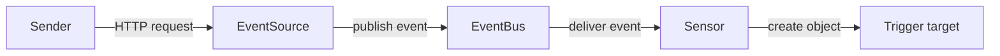

# Events And The Four Stages

A CronWorkflow starts a Workflow at a fixed time. That works when you know when the work is due. It does not work when the work is due because something happened at an unknown time: a data file landed in a bucket, a developer pushed a commit, or an alert fired. Polling for these occurrences wastes resources and adds delay, and every team writes its own polling script. Argo Events replaces the polling scripts with a fixed set of Kubernetes objects.

This part defines what an event is in Argo Events, describes the four stages that every event passes through, and shows the installed components in the playground.

## What an event is

An event is a record that something happened, plus the data that describes it. A webhook request is a common example. A webhook is an HTTP request that one system sends to another system's URL when something happens. A monitoring system that sends `POST /alert` with a JSON body is sending a webhook.

Argo Events wraps every occurrence, from any source, in the same envelope. The envelope follows the CloudEvents idea (a specification that describes event data in a common format). It has two parts. The first part is the **context**, which describes the event itself:

| Context field | Meaning |
| --- | --- |
| `type` | The kind of event source that produced it, for example `webhook` |
| `source` | The name of the EventSource object that produced it |
| `subject` | The name of the event inside that EventSource |
| `id` | A unique identifier for this event |
| `time` | When the event source saw the occurrence |
| `datacontenttype` | The format of the data, for example `application/json` |
| `specversion` | The version of the envelope format |

The second part is the **data**, which carries what the sender provided. For a webhook, the data has a `header` field with the HTTP headers of the request and a `body` field with the request body. This module reads the body with the path `body.message`, which means the `message` field of the JSON body.

An event describes a fact that already happened. It does not say what to do about it. The decision about what to do belongs to the configuration you write for the Sensor.

## The four stages

Every event passes through four stages, and a different component does the work in each one.



The diagram shows the order: the sender calls the EventSource, the EventSource publishes to the EventBus, the EventBus delivers to the Sensor, and the Sensor runs the trigger.

The **EventSource** receives or watches for occurrences. For a webhook EventSource, it runs an HTTP server that waits for requests. For a calendar EventSource, it runs a timer. For a resource EventSource, it watches Kubernetes objects. It converts each occurrence into the envelope and publishes it. It does not decide what happens next.

The **EventBus** transports events between EventSources and Sensors. Today the default backend is NATS JetStream, a message streaming server that stores events until a subscriber has processed them. The EventBus makes the EventSource and the Sensor independent: the EventSource does not know which Sensors exist, and a Sensor can restart without losing the events that arrived meanwhile, within the limits of the bus.

The **Sensor** subscribes to events. It lists its dependencies, which are the events it waits for, and it lists its triggers, which are the actions it runs when the dependencies are satisfied. The Sensor evaluates filters and conditions, so it is the stage where the decision is made.

The **trigger** is the action. The most common triggers create a Kubernetes object (an Argo Workflow, a Job or a Pod), or call an HTTP endpoint. The object that a trigger creates has its own lifecycle. A Workflow that was created successfully can still fail later, and that failure is not an Argo Events failure.

## Which object does which work

Each stage is a custom resource (an API object type added to Kubernetes by an extension). You write the custom resource, and the Argo Events controller creates the running parts.

| You write | The controller creates | That component does |
| --- | --- | --- |
| `EventBus` | A StatefulSet of JetStream servers and Services | Stores and delivers events |
| `EventSource` | A Deployment with one pod, and a Service when `spec.service` is set | Receives occurrences and publishes events |
| `Sensor` | A Deployment with one pod | Subscribes to events, evaluates dependencies, runs triggers |

The controller itself is a single Deployment named `controller-manager` in the `argo-events` namespace. It watches the three custom resources and creates or updates the Deployments and the StatefulSet. It does not carry events. If the controller stops, the existing EventSource, bus and Sensor pods keep running, but changes to the custom resources are not applied until it returns.

## Inspect the installed components

The playground has the controller installed but no pipeline yet. Start with the controller and the custom resource definitions (CRDs), which are the objects that teach the API server about the new kinds.

<!-- astrona:playground:renew -->

```sh
kubectl -n argo-events get deployment controller-manager
kubectl get crd | grep argoproj.io
```

The first command shows the controller Deployment and whether its pod is ready. The second command lists the Argo CRDs. You will find `eventbus.argoproj.io`, `eventsources.argoproj.io` and `sensors.argoproj.io` among them, next to the Argo Workflows CRDs such as `workflows.argoproj.io`.

List the resource types in the group to see their short names and whether they live in a namespace:

```sh
kubectl api-resources --api-group=argoproj.io
```

`EventBus`, `EventSource` and `Sensor` are namespaced. A pipeline therefore lives in one namespace, and the EventSource and the Sensor find their bus in their own namespace.

Check that no pipeline exists yet:

```sh
kubectl -n starfleet get eventbus,eventsources,sensors
```

The command reports that no resources were found, because nothing has been created yet.

## Events compared with schedules and manual runs

A manual run needs a person at the right moment. A schedule needs a fixed time. Both start work without checking whether the work is needed. An event starts work because the cause exists, so the work can be limited to the cases that matter. A Sensor can also look at the content of the event and ignore events that do not match its filter. That is why the same EventSource can feed several Sensors, and each one reacts to different events.

An event-driven design also moves a responsibility. When a person starts work by hand, the person judges whether the request is valid. When an HTTP request starts work, the pipeline must make that judgment, so later parts of this course spend time on authentication, filtering and safe repetition.

You now know what an event is, the four stages, and which Kubernetes object stands behind each stage. The open question is how these objects look in YAML and how they connect to each other, which is the subject of building the first pipeline.

## Common pitfalls

> [!WARNING]
> - **Thinking the EventSource runs the action.** The EventSource only publishes events. The Sensor decides and the trigger acts.
> - **Thinking the controller carries events.** The `controller-manager` creates and updates the pods. Events travel from the EventSource pod over the EventBus to the Sensor pod.
> - **Treating a created Workflow as a successful result.** A trigger that creates a Workflow has succeeded as a trigger. The Workflow can still fail afterwards.
> - **Looking for the pipeline in another namespace.** The EventBus, EventSource and Sensor of one pipeline must be in the same namespace.
