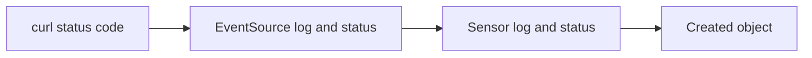

# Following One Event

A pipeline that does not produce its result gives one symptom: nothing happened. The cause can sit at four places, and each place has its own evidence. This part walks one event through every stage and names the object that holds the evidence for that stage. With this map, a failed pipeline becomes a question of which stage is the last one that worked.

The part starts from a fresh playground, so the pipeline is built from one file. Every new event creates another Workflow, so the order of the commands matters less than the habit of checking each stage.

## Build the pipeline from one file

A single file can hold several objects when they are separated by a line with three dashes. Save this as `pipeline.yaml`:

```yaml
apiVersion: argoproj.io/v1alpha1
kind: EventBus
metadata:
  name: default
  namespace: starfleet
spec:
  jetstream:
    version: 2.10.10
    replicas: 3
---
apiVersion: argoproj.io/v1alpha1
kind: EventSource
metadata:
  name: webhook
  namespace: starfleet
spec:
  service:
    ports:
      - port: 12000
        targetPort: 12000
  webhook:
    example:
      port: "12000"
      endpoint: /example
      method: POST
---
apiVersion: argoproj.io/v1alpha1
kind: Sensor
metadata:
  name: example
  namespace: starfleet
spec:
  template:
    serviceAccountName: event-trigger
  dependencies:
    - name: example-dep
      eventSourceName: webhook
      eventName: example
  triggers:
    - template:
        name: print-message
        k8s:
          operation: create
          source:
            resource:
              apiVersion: argoproj.io/v1alpha1
              kind: Workflow
              metadata:
                generateName: example-
              spec:
                serviceAccountName: workflow-runner
                entrypoint: print-message
                arguments:
                  parameters:
                    - name: message
                      value: unset
                templates:
                  - name: print-message
                    inputs:
                      parameters:
                        - name: message
                    container:
                      image: docker.io/library/busybox:1.37
                      command: [echo]
                      args: ["{{inputs.parameters.message}}"]
          parameters:
            - src:
                dependencyName: example-dep
                dataKey: body.message
              dest: spec.arguments.parameters.0.value
```

The file holds an EventBus, an EventSource and a Sensor, each in the namespace `starfleet`. Apply the file and wait for all three objects:

<!-- astrona:playground:renew -->

```sh
kubectl apply -f pipeline.yaml
kubectl -n starfleet wait --for=condition=Deployed eventbus/default --timeout=300s
kubectl -n starfleet wait --for=condition=Deployed eventsource/webhook --timeout=180s
kubectl -n starfleet wait --for=condition=Deployed sensor/example --timeout=180s
```

The pipeline is ready when the three waits return. The rest of the part sends events into it and reads the evidence stage by stage.

## Stage 1: did the request reach the EventSource

The first stage is the HTTP request. The EventSource pod listens on port 12000 and the Service `webhook-eventsource-svc` forwards to it. Test the Service from a pod in the same namespace:

```sh
kubectl -n starfleet exec shuttle -- curl -s -o /dev/null -w '%{http_code}\n' \
  -X POST -H 'Content-Type: application/json' \
  -d '{"message":"first event"}' \
  http://webhook-eventsource-svc:12000/example
```

The status code tells you where the request ended:

- A connection error from `curl` means the request did not reach a pod. Check that the Service exists and that it has endpoints.
- A `404` means a server answered, but no event listens on that path. The path in the request must equal the `endpoint` of the event.
- A `405` means the path is right but the HTTP method is not the one in the `method` field.
- A `200` means the EventSource accepted the request.

The Service and its endpoints are visible with:

```sh
kubectl -n starfleet get service webhook-eventsource-svc
kubectl -n starfleet get endpoints webhook-eventsource-svc
```

An empty endpoints list means that no ready pod matches the Service. The EventSource pod has labels that the controller sets, and the next command selects the pod through the label `eventsource-name`:

```sh
kubectl -n starfleet get pods -l eventsource-name=webhook
```

## Stage 2: did the EventSource publish to the bus

A webhook EventSource answers the request after the event has been handed to the EventBus. The pod log of the EventSource is the place to look when the status code is not `200`, or when it is `200` and the Sensor still does nothing:

```sh
kubectl -n starfleet logs -l eventsource-name=webhook --tail=50
```

The log lines are written by the controller code, and their exact text depends on the version. Read them for the name of the event, for connection errors to the bus, and for errors about the payload. An EventSource that cannot connect to the bus logs the connection error repeatedly and its status does not reach `Deployed`.

The status of the object itself is the second source of evidence:

```sh
kubectl -n starfleet get eventsource webhook -o jsonpath='{range .status.conditions[*]}{.type}={.status}{"\n"}{end}'
```

The command prints one line for each condition of the EventSource. The condition `Deployed` is `True` when the controller created the Deployment and the pod runs.

## Stage 3: did the Sensor receive the event

The Sensor pod subscribes to the subject of its dependency on the bus. When the event arrives, it checks filters and conditions, and only then runs the trigger. Read the Sensor log:

```sh
kubectl -n starfleet logs -l sensor-name=example --tail=50
```

Two kinds of lines are useful. A line that names the dependency means that the Sensor received an event for `example-dep`. A line about the trigger means that the Sensor started the trigger and it either finished or failed. Failures include the error that the Kubernetes API returned, for example a forbidden error when the service account of the Sensor lacks a permission.

The Sensor status has the same structure as the EventSource status:

```sh
kubectl -n starfleet get sensor example -o jsonpath='{range .status.conditions[*]}{.type}={.status}{"\n"}{end}'
```

When the event never arrives at the Sensor, compare the pair `eventSourceName` and `eventName` in the dependency with the EventSource. A mismatch is the most common reason for silence at this stage, because the Sensor subscribes without error to a subject that no one publishes to.

## Stage 4: did the trigger create the object

The last stage is the effect. The trigger here creates a Workflow, so the Workflow list is the proof:

```sh
kubectl -n starfleet get workflows
```

Each event produces one Workflow because of `generateName`. Send three events in a row and the list holds three more objects:

```sh
for n in 1 2 3; do
  kubectl -n starfleet exec shuttle -- curl -s -o /dev/null \
    -X POST -H 'Content-Type: application/json' \
    -d "{\"message\":\"event $n\"}" \
    http://webhook-eventsource-svc:12000/example
done
kubectl -n starfleet get workflows -o jsonpath='{range .items[*]}{.metadata.name}{"\t"}{.spec.arguments.parameters[0].value}{"\n"}{end}'
```

The second command prints the name and the message argument of every Workflow. The names are different because the API server adds a random suffix. The messages show that each event carried its own data into its own object.

If a Workflow exists, the Argo Events part of the work is done. A Workflow that exists but does not finish is a problem of Argo Workflows, for example a missing service account for the pod or an image that cannot be pulled. The command `kubectl -n starfleet describe workflow <name>` shows its status and events.

## The order of questions



The diagram is the order in which to ask. Start at the left, and stop at the first stage whose evidence is wrong. Everything to the right of that stage is a consequence and does not need to be inspected yet.

The same order explains the cost of each stage. The first two stages involve one pod and a Service. The third stage involves the bus, so a problem there is often a name that does not match or a bus that is not ready. The fourth stage involves the Kubernetes API, so a problem there is almost always permissions or an invalid object in the trigger template.

## Common pitfalls

> [!WARNING]
> - **Reading logs of the controller instead of the pods.** The controller reports about the objects. The event flow is logged by the EventSource pod and the Sensor pod in the namespace of the objects.
> - **Treating a `200` as proof of a Workflow.** The `200` only shows that the EventSource accepted the request. The Sensor decides whether a trigger runs.
> - **Looking for the Workflow in another namespace.** The Workflow is created in the namespace in the trigger template, or in the namespace of the Sensor when the template has none.
> - **Sending to the wrong path.** The path in the URL must equal the `endpoint` of the event exactly, including the leading slash.
