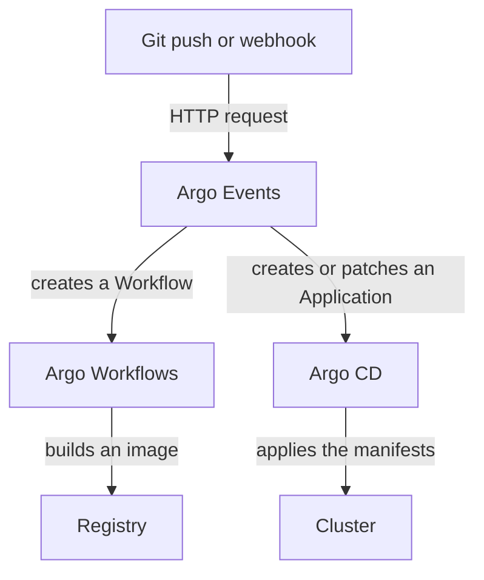

# Argo Events And The Other Argo Projects

Argo Events does one job: it turns an outside change into an object in the cluster. It does not run containers in a sequence, deploy applications from Git or roll out new versions. Other projects do those jobs. A reader who knows which project owns which task can read an architecture diagram, choose the right tool and answer the exam questions that compare them.

This part names the four Argo projects, says what each one does and shows how Argo Events fits next to them. It also shows in the playground that two of them are installed side by side in one cluster.

## The four projects and their jobs

The Argo projects are a family of Kubernetes tools. Each one adds its own custom resource definitions (CRDs), which are new object kinds in the Kubernetes API, and each one runs its own controller.

- Argo Workflows runs jobs as containers. A `Workflow` object holds steps or a graph of tasks, and the Workflows controller creates one pod for each step. Use it for batch jobs, data pipelines and continuous integration.
- Argo Events reacts to outside changes. An EventSource receives an event, a Sensor decides what to do and a trigger creates an object or sends a request. Use it when something that happens outside the cluster, or on a clock, must start work.
- Argo CD keeps the cluster equal to a Git repository. An `Application` object points at a path in a repository, and the Argo CD controller applies the files and corrects any drift. Use it for continuous delivery.
- Argo Rollouts replaces the Kubernetes `Deployment` for applications that need progressive delivery. A `Rollout` object moves traffic to a new version in steps, such as a canary or a blue-green release, and it can stop and roll back on a failed metric check.

Argo Events is the only one of the four that waits for something. The other three act on an object that already exists. That is why Argo Events often sits at the start of a larger flow.



The diagram shows one common design. Argo Events receives the request and creates the objects. Argo Workflows and Argo CD do the work after that. Argo Events does not call them through a special integration. It uses a generic trigger that creates a Kubernetes object, and any object with a CRD, including a `Workflow` or an `Application`, can be created that way.

## What Argo Events adds to Argo Workflows

Argo Workflows has its own scheduling object, the `CronWorkflow`, which starts a Workflow on a cron schedule. It has no way to start a Workflow from a request or from a change of an object. Argo Events covers that gap. The webhook EventSource turns an HTTP request into an event, and the resource EventSource turns a change of any Kubernetes object into an event. The Sensor filters the events and the Argo Workflow trigger submits the Workflow.

Argo Events can also start things that are not Workflows. The HTTP trigger calls any web address, the Kubernetes trigger creates any object, and the other triggers publish to messaging systems or call a function service. For the CAPA exam, remember the split: Argo Events decides when to start and with what data, and the target decides what the work is.

## Look at the installed projects

The playground has Argo Workflows and Argo Events installed in the same cluster. Each one has its own namespace and its own controller. Argo CD and Argo Rollouts are not installed.

<!-- astrona:playground:renew -->

List the controllers of the two projects:

```sh
kubectl -n argo get deployments
kubectl -n argo-events get deployments
```

The first command shows the Workflows controller, `workflow-controller`. The second shows the Argo Events controller, `controller-manager`. The two controllers do not share any code or any state. They meet only through objects in the Kubernetes API.

Now list the object kinds that each project added to the API:

```sh
kubectl api-resources --api-group=argoproj.io
```

All of the kinds are in the API group `argoproj.io`, which every Argo project uses. The list has `eventbus`, `eventsources` and `sensors` from Argo Events, and `workflows`, `workflowtemplates` and `cronworkflows` from Argo Workflows. A trigger can create a `workflows` object because it is a normal object of the API, like a pod.

Last, check that the Sensor service account in the playground may create Workflows, and that it may not create other objects:

```sh
kubectl auth can-i create workflows.argoproj.io -n starfleet --as=system:serviceaccount:starfleet:event-trigger
kubectl auth can-i create deployments.apps -n starfleet --as=system:serviceaccount:starfleet:event-trigger
```

The first command prints `yes` and the second prints `no`. The permission to create an object belongs to the service account of the Sensor, and Argo Events itself grants no permission for the objects that a trigger creates.

## Events compared with other ways to start work

A Kubernetes `CronJob` starts a pod on a schedule. A `CronWorkflow` starts a Workflow on a schedule. A person can also run `argo submit`. These are the right choices when the start is a time or a manual decision and the job needs no data from the start. They are not enough when the job must start because a file arrived, a commit was pushed or an alert fired, and when the job needs a value from that event.

Argo Events also separates the sender from the job. The sender only needs the address of an EventSource. It does not need Kubernetes credentials. The permissions to create objects stay with the Sensor, so a sender can be an outside system that has no access to the cluster API.

This part placed Argo Events next to the other Argo projects: it receives events and creates objects, and the other projects run, deliver or roll out what those objects describe. The open question is how an event gets from the outside into the cluster, and the EventSource types answer it.

## Common pitfalls

> [!WARNING]
> - **Looking for a Workflow engine inside Argo Events.** Argo Events creates a Workflow object, but only the Argo Workflows controller runs it. Without it, the Workflow stays unprocessed.
> - **Expecting Argo Events to deploy applications from Git.** That is the job of Argo CD. Argo Events can only create or patch the objects that a Sensor is allowed to touch.
> - **Giving the Sensor service account broad permissions.** It needs only the verbs and resources of the objects that its triggers create.
> - **Using Argo Events for a plain schedule.** A `CronWorkflow` or a `CronJob` is simpler when a clock is the only reason to start. Use the calendar EventSource when the schedule must go through Sensors and filters like any other event.
