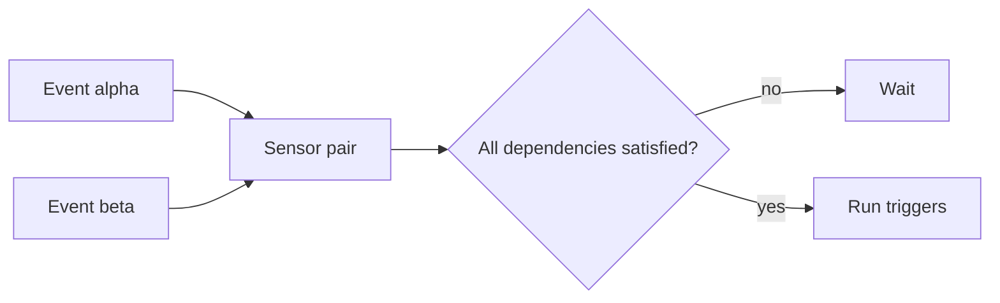

# Sensor Anatomy And Dependencies

A Sensor answers one question for every event that passes the EventBus: is this enough reason to act? For one event the answer is simple. For two events that belong together, such as a build that finished and an approval that arrived, the answer needs a rule. This part shows what a Sensor is made of, what happens when it has more than one dependency, and how several Sensors can react to the same event.

The EventBus `default` already exists in the playground. Everything else in this part is created by you.

## The three parts of a Sensor

A Sensor has three kinds of content:

- `spec.dependencies` is a list of events that the Sensor waits for. Each dependency has a `name`, an `eventSourceName` and an `eventName`. The name is a label that is local to the Sensor. The other two values point at one event of one EventSource.
- `spec.triggers` is a list of actions. Each trigger is a `template` with a name and one action type, such as `k8s`, `argoWorkflow` or `log`.
- `spec.template` is the pod template of the Sensor pod. The most used field in it is `serviceAccountName`, because the Sensor pod runs the triggers with that identity.

The controller turns the Sensor object into a Deployment with one pod. The pod subscribes to the EventBus for every dependency. When a message arrives, the pod checks the dependency rule, and if the rule is met it runs the triggers.

## Create the events

Save this as `eventsource-gateway.yaml`. It has two webhook events on two ports:

```yaml
apiVersion: argoproj.io/v1alpha1
kind: EventSource
metadata:
  name: gateway
  namespace: starfleet
spec:
  service:
    ports:
      - port: 12000
        targetPort: 12000
      - port: 13000
        targetPort: 13000
  webhook:
    alpha:
      port: "12000"
      endpoint: /alpha
      method: POST
    beta:
      port: "13000"
      endpoint: /beta
      method: POST
```

<!-- astrona:playground:renew -->

Apply it and wait until the controller has created the pod:

```sh
kubectl apply -f eventsource-gateway.yaml
kubectl -n starfleet wait --for=condition=Deployed eventsource/gateway --timeout=180s
```

## One Sensor with two dependencies

Save this Sensor as `sensor-pair.yaml`. It depends on both events and uses a log trigger, which prints what it receives and needs no permission:

```yaml
apiVersion: argoproj.io/v1alpha1
kind: Sensor
metadata:
  name: pair
  namespace: starfleet
spec:
  dependencies:
    - name: alpha
      eventSourceName: gateway
      eventName: alpha
    - name: beta
      eventSourceName: gateway
      eventName: beta
  triggers:
    - template:
        name: both-arrived
        log: {}
```

The dependency names are `alpha` and `beta`. They are chosen here to equal the event names, but they do not have to. Apply the Sensor and wait for it:

```sh
kubectl apply -f sensor-pair.yaml
kubectl -n starfleet wait --for=condition=Deployed sensor/pair --timeout=180s
```

Send the first event and read the Sensor log. The command `kubectl logs` with the label `sensor-name` selects the pod that the controller created for the Sensor:

```sh
kubectl -n starfleet exec shuttle -- curl -s -X POST -H 'Content-Type: application/json' -d '{"ship":"scout"}' http://gateway-eventsource-svc:12000/alpha
kubectl -n starfleet logs -l sensor-name=pair --tail=20
```

The log does not show the payload of the event, because the trigger did not run. The upstream documentation states the rule: when no condition is given, the trigger runs only after all dependencies are satisfied. One event is only half of what this Sensor asks for.

Now send the second event and read the log again:

```sh
kubectl -n starfleet exec shuttle -- curl -s -X POST -H 'Content-Type: application/json' -d '{"ship":"relay"}' http://gateway-eventsource-svc:13000/beta
kubectl -n starfleet logs -l sensor-name=pair --tail=20
```

This time the log trigger runs, and the log shows the payloads of the events that the trigger received. Look for both `scout` and `relay` in the output. The exact layout of the log lines depends on the version, so read it instead of comparing it to a template.



The diagram shows the default rule: the Sensor waits until each of its dependencies has delivered an event, and only then runs the triggers.

## Change the rule with conditions

The default rule is an AND of all dependencies. A trigger can state another rule in its `conditions` field. The field holds a boolean expression over dependency names. The operators are `&&` for and, `||` for or, and parentheses for grouping. Save this as `sensor-either.yaml`:

```yaml
apiVersion: argoproj.io/v1alpha1
kind: Sensor
metadata:
  name: either
  namespace: starfleet
spec:
  dependencies:
    - name: alpha
      eventSourceName: gateway
      eventName: alpha
    - name: beta
      eventSourceName: gateway
      eventName: beta
  triggers:
    - template:
        name: one-arrived
        conditions: "alpha || beta"
        log: {}
```

Apply it, wait, send only the `alpha` event and read the log of the new Sensor:

```sh
kubectl apply -f sensor-either.yaml
kubectl -n starfleet wait --for=condition=Deployed sensor/either --timeout=180s
kubectl -n starfleet exec shuttle -- curl -s -X POST -H 'Content-Type: application/json' -d '{"ship":"probe"}' http://gateway-eventsource-svc:12000/alpha
kubectl -n starfleet logs -l sensor-name=either --tail=20
```

The log trigger runs after one event, because `alpha || beta` is true as soon as `alpha` has arrived. The same event also went to the Sensor `pair`, which still waits for `beta`. Two Sensors read the same message and decided differently, because each Sensor keeps its own state.

The upstream documentation also describes `conditionsReset`. It clears the remembered events of a Sensor at a time that a cron expression gives, so that a half-complete set of events does not stay valid for ever. The point here is that the rule belongs to the trigger, and that a Sensor can hold several triggers with different rules.

## Several Sensors on one event

A dependency only reads. It does not consume the event. Any number of Sensors can depend on the same event, and each one receives its own copy. This is how one deployment event can start a test run, send a notice and write an audit record at the same time, without the EventSource knowing about any of them.

Check this on the objects you created. Both Sensors listed their dependency on the event `alpha`:

```sh
kubectl -n starfleet get sensors
kubectl -n starfleet get pods -l eventsource-name=gateway
kubectl -n starfleet get pods -l sensor-name=pair
kubectl -n starfleet get pods -l sensor-name=either
```

There is one EventSource pod and one pod for each Sensor. The pods do not know about each other. The EventBus is the only thing they share.

The inverse is also allowed. One Sensor can have dependencies on events of different EventSources, for example a webhook and a calendar. The dependency rule does not care where an event comes from.

## Common pitfalls

> [!WARNING]
> Three mistakes cost the most time in this area.
>
> - A Sensor with two dependencies and no `conditions` never runs when only one of the events ever arrives. The Sensor shows as healthy, and the log stays quiet. When a trigger must run on either event, write the condition `a || b`.
> - A name in `conditions` must be a dependency `name`, not an event name. When the two differ, the expression refers to the wrong thing or to nothing.
> - The `eventSourceName` is the `metadata.name` of the EventSource, and the `eventName` is the key under the type. Swapping them, or using the type such as `webhook`, gives a Sensor that never receives an event and reports no error.
