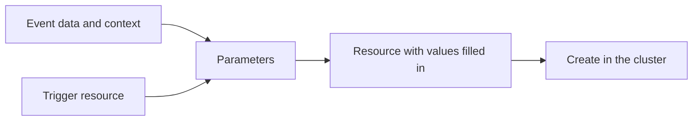

# Passing Event Data To Triggers

A trigger that creates the same object every time is rarely useful. A deployment event carries the name of the application, a ticket event carries a ticket number, and an alert carries a severity. The object that the trigger creates must contain those values, and the trigger template is written before any event exists. Parameterization closes this gap. It copies values out of an event and writes them into the trigger template at the moment the trigger runs.

The EventBus `default` already exists in the playground. Everything else in this part is created by you.

## The two sources of values

Every event that reaches a Sensor has two parts:

- The data is the payload. For a webhook event it is a JSON object with the keys `header` and `body`. The `body` is the JSON that the caller sent.
- The context describes the event itself. It has fields such as `id`, `source`, `type`, `subject` and `time`. For the events used here, the `subject` is the name of the event, and the `source` is the name of the EventSource. The `time` is the moment the EventSource created the event.

A parameter reads from one of them and writes into the trigger resource. Parameters are a list under the trigger, written next to `source` inside the `k8s` section. Each parameter has a `src`, which says what to read, and a `dest`, which says where to write.

## Create the events and a Sensor

Save this as `eventsource-depot.yaml`:

```yaml
apiVersion: argoproj.io/v1alpha1
kind: EventSource
metadata:
  name: depot
  namespace: starfleet
spec:
  service:
    ports:
      - port: 12000
        targetPort: 12000
  webhook:
    load:
      port: "12000"
      endpoint: /load
      method: POST
```

<!-- astrona:playground:renew -->

Apply it and wait until it is deployed:

```sh
kubectl apply -f eventsource-depot.yaml
kubectl -n starfleet wait --for=condition=Deployed eventsource/depot --timeout=180s
```

Now the Sensor. It creates a Workflow with two parameters, `message` and `priority`, and it fills three places with values from the event. Save this as `sensor-cargo.yaml`:

```yaml
apiVersion: argoproj.io/v1alpha1
kind: Sensor
metadata:
  name: cargo
  namespace: starfleet
spec:
  template:
    serviceAccountName: event-trigger
  dependencies:
    - name: load-dep
      eventSourceName: depot
      eventName: load
  triggers:
    - template:
        name: record-load
        k8s:
          operation: create
          source:
            resource:
              apiVersion: argoproj.io/v1alpha1
              kind: Workflow
              metadata:
                generateName: cargo-
              spec:
                serviceAccountName: workflow-runner
                entrypoint: report
                arguments:
                  parameters:
                    - name: message
                      value: unset
                    - name: priority
                      value: unset
                templates:
                  - name: report
                    inputs:
                      parameters:
                        - name: message
                        - name: priority
                    container:
                      image: docker.io/library/busybox:1.37
                      command: [sh, -c]
                      args: ["echo {{inputs.parameters.priority}} {{inputs.parameters.message}}"]
          parameters:
            - src:
                dependencyName: load-dep
                dataTemplate: "{{ .Input.body.ship | upper }} carries {{ .Input.body.cargo }}"
              dest: spec.arguments.parameters.0.value
            - src:
                dependencyName: load-dep
                dataKey: body.priority
                value: normal
              dest: spec.arguments.parameters.1.value
            - src:
                dependencyName: load-dep
                contextKey: subject
              dest: metadata.generateName
              operation: append
```

Apply it and wait for the Sensor:

```sh
kubectl apply -f sensor-cargo.yaml
kubectl -n starfleet wait --for=condition=Deployed sensor/cargo --timeout=180s
```

The next sections explain each of the three parameters. First send an event without a priority and read the result:

```sh
kubectl -n starfleet exec shuttle -- curl -s -X POST -H 'Content-Type: application/json' -d '{"ship":"scout","cargo":"fuel"}' http://depot-eventsource-svc:12000/load
kubectl -n starfleet get workflows -o jsonpath='{range .items[*]}{.metadata.name}{"\t"}{.spec.arguments.parameters[*].value}{"\n"}{end}'
```

The command prints one line for the new Workflow. The name starts with `cargo-load`, and the values are `SCOUT carries fuel` and `normal`. The Sensor needs a few seconds to react, so repeat the second command when the list is empty.

Send a second event with a priority and list the Workflows again:

```sh
kubectl -n starfleet exec shuttle -- curl -s -X POST -H 'Content-Type: application/json' -d '{"ship":"relay","cargo":"water","priority":"high"}' http://depot-eventsource-svc:12000/load
kubectl -n starfleet get workflows -o jsonpath='{range .items[*]}{.metadata.name}{"\t"}{.spec.arguments.parameters[*].value}{"\n"}{end}'
```

The second Workflow has `RELAY carries water` and `high`.

## Data key, template and default

The first parameter uses `dataTemplate`. A data template is a Go template with the functions of the sprig library, and the event data is available as `.Input`. The template here reads two keys of the body and turns the ship name into upper case with the function `upper`. The result is a string, and it is written to the destination path.

The second parameter uses `dataKey`. A data key is a path into the event data, with dots between the levels. The path `body.priority` reads the key `priority` from the JSON that the caller sent. The field `value` next to it is the default. When the key does not exist in the event, the parameter uses the value instead of failing. That is why the first event produced `normal` and the second produced `high`. Without a default, an event that lacks the key makes the parameter fail, and the trigger does not run for that event. The default is used only for a missing key or a missing event.

The context has the same two forms. `contextKey` reads one context field, and `contextTemplate` runs a template over the context. The third parameter above uses `contextKey` with the field `subject`. When a parameter names both a data and a context source, the data source is used and the context source is ignored. Write one source per parameter to keep the meaning clear.

| Source field | Reads from | Result |
| --- | --- | --- |
| `dataKey` | A path in the event data | The value at the path |
| `dataTemplate` | A template over the event data | The rendered text |
| `contextKey` | A field of the event context | The value of the field |
| `contextTemplate` | A template over the event context | The rendered text |
| `value` | Nothing | A fixed default when the key is missing |

A parameter always names one dependency with `dependencyName`. This matters for Sensors that use an `||` condition, because then the trigger can run while the named dependency has delivered nothing. In that case a parameter without `value` is skipped and leaves the placeholder in the template as it is. A parameter with `value` writes the default. A Sensor that must copy a field from whichever event arrived therefore needs one parameter for each dependency, all without `value`, so that only the parameter of the dependency that delivered an event writes.

The resolution also falls back in order. When a template fails, the parameter tries its key. When the key does not exist, it uses `value`. When there is no `value`, the parameter fails, and the trigger does not run.

## Destination and operation

The `dest` field is a path inside the trigger resource. Numbers in the path are list positions that start at zero. The path `spec.arguments.parameters.0.value` is the field `value` of the first entry of the Workflow arguments. A path that does not match the structure of the resource makes the trigger fail, so the order of the list in the resource matters.

The `operation` field says how the new value meets the old value at the destination. The default is `overwrite`, which replaces the old value. The operation `append` puts the new value after the old one, and `prepend` puts it before. The third parameter uses `append` on `metadata.generateName`. The old value is `cargo-`, the new value is the event name `load`, and the result is `cargo-load`. The cluster then adds a random suffix when it creates the object. Both Workflows in the check above therefore start with `cargo-load`. With `prepend` the same parameter gives `loadcargo-`, which is why `append` is the right choice for a name that must keep its prefix.



The diagram shows the order: the parameters read the event, write into a copy of the trigger resource, and only then does the trigger create the object.

## Check what the template does

A parameter writes into the resource, not into the Sensor object. The Sensor you applied still contains the values `unset`, and every event gets its own copy. Confirm this by reading the Sensor and comparing it to a Workflow:

```sh
kubectl -n starfleet get sensor cargo -o jsonpath='{.spec.triggers[0].template.k8s.source.resource.spec.arguments.parameters[*].value}{"\n"}'
```

The command prints `unset unset`. The placeholder values in a template are only defaults for the case that a parameter does not write. Use an obvious placeholder, because a value such as `unset` in a created object tells you at once that a parameter did not apply.

## Common pitfalls

> [!WARNING]
> These mistakes are common in parameterization.
>
> - The `dest` path counts list positions from zero. Writing `parameters.1` into a resource that has one parameter fails when the trigger runs, not when the Sensor is applied.
> - A `dataKey` for a key that does not exist and has no `value` makes the parameter fail. Add a default for every optional key.
> - `dataKey` and `dataTemplate` read the data of the event, and the data of a webhook event keeps the caller JSON under `body`. The path `ship` reads nothing, and the path `body.ship` reads the key that the caller sent.
> - A `value` on a parameter that names a dependency which did not deliver an event overwrites the real value that another parameter wrote earlier. Use `value` for one dependency at a time, or not at all, when a Sensor has an `||` condition.
> - The Workflow template must have a place for the value. A parameter that writes to `spec.arguments.parameters.0.value` has no effect on a template that never uses `{{workflow.parameters.message}}` or an input of that name.
