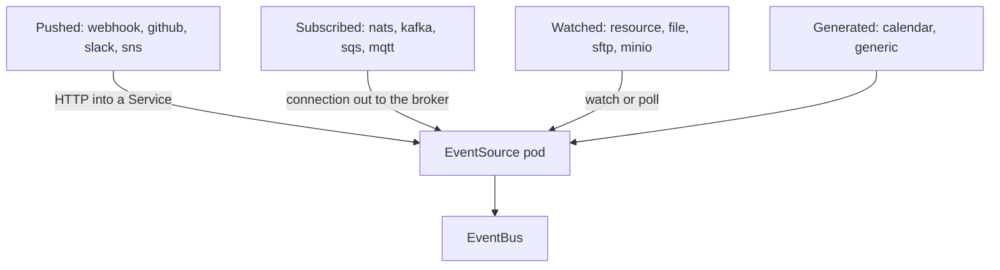

# The EventSource Catalogue

An EventSource is one Kubernetes object, but it can listen to very different things. Choosing the right type, and knowing what each type needs from the cluster and from the outside system, is a large part of designing a pipeline. A type that waits for pushed requests needs an address that the sender can reach. A type that subscribes to a queue needs credentials and a route to the queue instead.

This part sorts the types into four groups by how the event reaches the EventSource. It explains what each group needs, and it gives the rule for how many pods may run. It has no commands.

## One field per type

Under `spec`, an EventSource has one field for each type that it uses. The field name is the type, such as `webhook`, `calendar` or `nats`. The value is a map in which each key is the name of one event, and each event holds the settings of that type. This is why the examples so far read `spec.webhook.order` or `spec.calendar.beat`: `webhook` is the type, and `order` and `beat` are event names.

The type names include `webhook`, `calendar`, `resource`, `file`, `nats`, `kafka`, `amqp`, `mqtt`, `redis`, `redisStream`, `pulsar`, `nsq`, `emitter`, `github`, `gitlab`, `bitbucket`, `bitbucketserver`, `gerrit`, `slack`, `stripe`, `sns`, `sqs`, `gcpPubSub`, `azureEventsHub`, `azureQueueStorage`, `azureServiceBus`, `minio`, `storageGrid`, `hdfs`, `sftp` and `generic`. A release can add types, so check the list of the installed version.

The custom resource definition accepts any field under `spec`, so a misspelled type name is not refused when you apply the object. The EventSource simply has no events for it.

## Group 1: the sender pushes a request

The webhook type listens on a port, and the sender calls it. The GitHub, GitLab, Bitbucket, Slack, Stripe and SNS types work the same way: the outside service calls an HTTP address of the EventSource when something happens. These types need a Service for the port, and the outside service must reach that Service, usually through an Ingress or a load balancer with a public address.

Pushed types fit the active-active model. Several pods can run at once, because the sender sends each request to one pod through the Service, so no event arrives twice.

## Group 2: the EventSource subscribes

The Kafka, NATS, AMQP, MQTT, Redis, Pulsar, NSQ, Emitter, Amazon SQS, Google Pub/Sub and Azure types connect from the EventSource pod to a broker and wait for messages. The connection goes out of the cluster, or to a service in the cluster. No Service is needed for the EventSource, and nothing outside has to reach it.

The EventSource needs the address of the broker and, usually, credentials, which it reads from Secrets in its namespace. Subscribed types run as one active pod with standby pods. Two active pods on the same subject would each receive the message, and the event would be published twice, so the controller lets only the elected leader consume.

## Group 3: the EventSource watches

The resource type watches the Kubernetes API. The file type watches a path in the filesystem of its pod. The SFTP and HDFS types look for changes on a remote server. The MinIO and StorageGrid types listen to notifications about objects in a bucket. These types also work from the pod outward and also run as one active pod with standby pods.

A watching type reads its target with the permissions of its pod. The resource type needs a Role that allows `get`, `list` and `watch` on the watched kind, and the other types need the credentials of the remote system.

## Group 4: the EventSource generates

The calendar type produces an event from the clock, and the generic type receives events from your own gRPC server that implements the EventSource protocol. The generic type is the extension point for sources that have no built-in type. The EventSource connects to your server and publishes what it streams.

The diagram shows that the four groups differ only in how the event gets to the EventSource pod. After that, every event goes to the EventBus in the same way.

## What every type shares

All types share the same data shape for what Sensors see, with a different `body` or payload field. Every event gets an event context with the type name as its `type`, the EventSource name as its `source` and the event name as its `subject`. Every type also reads the shared fields of the EventSource: `eventBusName`, `replicas`, `template` and, for pushed types, `service`.

The names of events must be unique inside one EventSource, across all of its types. The set of names is what a Sensor addresses, so two events with one name would be ambiguous.

## Choosing a type

Start from the system that produces the event. If it can call an HTTP address, a pushed type is the simplest, and `webhook` works for any system that does not have a type of its own. If it publishes to a broker that you already run, use the subscription type of that broker, because the broker keeps the messages that arrive while the EventSource is down. If it exposes changes through an API that you can poll or watch, use a watching type. If no built-in type exists, use the generic type or put a small adapter in front of a webhook.

This part sorted the types by how events arrive and by what each group needs. The practical question that remains is what the settings of one subscription type look like.

## Common pitfalls

> [!WARNING]
> - **Assuming every type needs a Service.** Only pushed types listen on a port. A subscription type opens a connection out and needs no Service.
> - **Running several replicas of a subscription type and expecting parallel work.** The standby pods wait for the leader to fail.
> - **Misspelling the type name.** The custom resource definition does not refuse it, and the EventSource silently has no events.
> - **Reusing an event name in two types of one EventSource.** Names must be unique across the whole EventSource.
> - **Exposing a pushed type without authentication.** Any sender that can reach the Service can create events. Use the authentication fields of the type.
