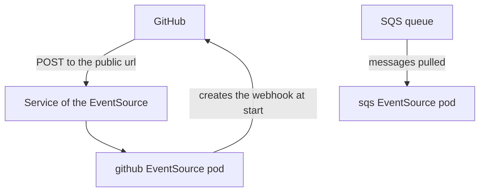

# Source Control And Cloud EventSources

The most common outside event sources are a Git hosting service that reports a push or a pull request, a chat service that reports a command, and a cloud queue that holds work items. These services need accounts, tokens and public addresses, so the playground cannot run them. You can still learn their settings, because the types follow the patterns of the first two groups: some register a webhook and receive requests, and some poll a queue.

This part describes the GitHub, Slack, SNS and SQS types field by field. It shows what each field does, which Secret holds which credential and which type needs a public address. It runs no command, because the settings only mean something with a real account.

## GitHub: register a webhook and receive it

The `github` type does two jobs. At start, the EventSource pod calls the GitHub API with an access token and creates a webhook on each repository that you list. After that, GitHub sends a request to the address of the webhook for every selected event, and the EventSource serves that address like a webhook EventSource. The fields are:

- `repositories` lists the repositories as an owner and a list of names.
- `events` lists the GitHub event names to subscribe to, for example `push`, `pull_request` or `create`. The value `"*"` selects all of them.
- `apiToken` is a reference to a Secret key that holds a personal access token which may create webhooks.
- `webhookSecret` is a reference to a Secret key that holds a shared secret. GitHub signs each request with it, and the EventSource checks the signature.
- `webhook` holds the `endpoint`, the `port`, the `method` and the public `url` that GitHub is given. The `url` is the address that GitHub can reach from the internet, for example the address of an Ingress.
- `contentType` is `json` or `form`, and `insecure` turns off the check of the TLS certificate on the public address.
- `active` switches the webhook on at GitHub, and `deleteHookOnFinish` removes the webhook when the EventSource stops.

Because GitHub calls the EventSource, the type needs a Service and a route from the internet to it. It also needs outbound access to the GitHub API at the start. The GitLab, Bitbucket and Gitea types follow the same pattern with their own field names.

The data of a GitHub event has the HTTP `headers`, with the event name in `X-GitHub-Event`, and the `body`, which is the JSON that GitHub sent. A Sensor filters on both: a data filter on the header selects the event type, and one on the body selects, for example, the branch name in `body.ref`.

## Slack: slash commands and events

The `slack` type receives requests from a Slack application. The `signingSecret` is a reference to the secret that Slack uses to sign its requests, and the EventSource uses it to refuse forged requests. The `token` is the bot token. The `webhook` field holds the endpoint and the port. The type serves HTTP, so it needs a Service and a public address, as the GitHub type does.

## SNS: notifications from AWS

The `sns` type is a pushed type for Amazon Simple Notification Service. The EventSource serves an endpoint and, at start, subscribes that endpoint to a topic. The fields are the `topicArn`, the `webhook` with the public `url`, the `region`, and the `accessKey` and `secretKey` as Secret references. The Boolean `validateSignature` makes the EventSource check the signature that SNS adds to each message. Use it, because otherwise any caller that knows the address can send fake notifications.

## SQS: polling a queue

The `sqs` type is a subscription type, so it needs no Service and no public address. The EventSource pod calls the Simple Queue Service API and waits for messages. The fields are the `queue` name, the `region`, the `accessKey` and `secretKey` as Secret references, and `waitTimeSeconds`, which sets how long one request waits for messages (long polling, 1 to 20 seconds). With `jsonBody: true`, the message body is embedded as JSON. The EventSource removes a message from the queue after it publishes the event.

Compare the two Amazon types. SNS pushes to your address and needs inbound access. SQS is pulled by your pod and needs outbound access only. In an environment that does not allow inbound traffic from the internet, SQS or another subscription type is the practical choice.

## Credentials and permissions

Every field that ends in `Secret`, `Token` or `Key` is a reference with a `name` (a Secret) and a `key` (an entry in that Secret). The Secret must exist in the namespace of the EventSource before the EventSource is applied. Create it with `kubectl create secret generic`, for example `kubectl -n starfleet create secret generic github-access --from-literal=token=<TOKEN>`, where `<TOKEN>` is the value you get from the service.

Give each token only the permission it needs: a GitHub token that creates webhooks, an AWS user that may only receive and delete from one queue. If the token is wrong or too weak, the EventSource pod fails at start, and the reason is in its log and in the status of the EventSource.

The diagram contrasts the two patterns. The GitHub pod is called and also calls out once at start. The SQS pod only calls out.

This part gave the fields of four outside types and the pattern behind them. The remaining question is how an EventSource holds several types at once.

## Common pitfalls

> [!WARNING]
> - **Leaving out `webhook.url` for GitHub or SNS.** The service cannot send requests to a cluster address, so it needs the public one.
> - **Skipping `webhookSecret` or `validateSignature`.** The EventSource then accepts requests from anyone who finds the address.
> - **Putting a token directly in the EventSource.** Tokens are always Secret references.
> - **Giving the token more permissions than needed.** A leaked token of an EventSource should not be able to change more than the source.
> - **Choosing a pushed type behind a firewall.** The outside service cannot reach it. Use a subscription type.
