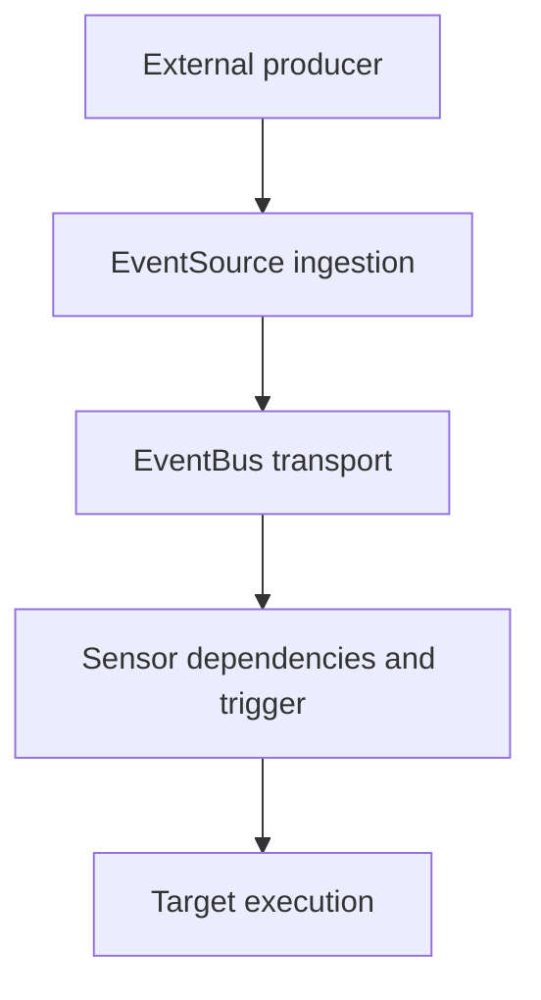

# EventSource, EventBus And Sensor Architecture

Argo Events separates event ingestion, transport and trigger decisions into components with distinct responsibilities. EventSource, EventBus and Sensor resources describe those responsibilities, while controllers create and manage their active execution components. This architecture provides a useful model for diagnosing a missing or repeated action.

## EventSource Owns Ingestion

An EventSource configures one or more supported external event adapters. A webhook adapter listens for requests, while another adapter can consume messages or observe a system under its contract. The adapter needs appropriate credentials, network exposure and source-specific configuration.

The resource's existence does not prove its listener is reachable or authenticated correctly. A Service, external route or message subscription can fail independently of the source Pod. Establish whether the external event actually reached the adapter before investigating downstream task execution.

## EventBus Owns Transport

The EventBus provides the configured transport between sources and consumers. Supported backends have different persistence, acknowledgment and operational requirements. Select the intended implementation and assess its capacity, availability and retention behavior rather than assume every backend has identical delivery guarantees.

A bus accepting an event is not proof that a Sensor processed it. Consumer connectivity, backlog and failure handling can affect the next stage. Event identity and timing help distinguish delayed processing from complete absence, while transport retries can contribute to duplicates under the actual delivery model.

## Sensor Owns Dependency And Trigger Logic

A Sensor names dependencies on configured event-source relationships and evaluates supported conditions and filters. When its condition is satisfied, it invokes the configured trigger. The dependency name, source name and event name must agree with the producer's configured identity.

A mismatch can leave a healthy Sensor waiting indefinitely for a relationship that never occurs. A filter can also reject an event whose payload does not meet the condition. Differentiate no matching event from a trigger request that was attempted and failed.

## Envelope And Payload Have Different Roles

Events use supported envelope metadata and payload structure. Metadata can identify source, type, identity and timing, while data contains the source-specific content. Trigger mappings must refer to the appropriate field and handle missing or incompatible values deliberately.

Do not treat every payload field as trusted control input. A value choosing an arbitrary image, command or destination can influence downstream authority. Validate the intended contract and keep sensitive credentials out of unnecessary event fields and diagnostic views.

## The Trigger Target Has Another Lifecycle

A Sensor can request creation of a Workflow or another supported action using its API permissions. Successful creation establishes that request, not final processing success. The target's controller, Pods, artifacts and external side effects then provide separate evidence.

Correlate event identity, trigger attempt and target resource identity to follow the chain. If an acknowledgment or response is uncertain, repetition may occur; use safe naming, deduplication or idempotent business operations appropriate to the design. Controller status, component logs and target outcomes each explain a different boundary. A complete diagnosis follows the first failed transition rather than equate one Ready component with end-to-end success.

## Event Responsibility Chain

A transition can fail or repeat independently of its neighbors. Correlated event and target identities are needed to explain whether an occurrence became a successful business result.

## Common pitfalls

> [!WARNING]
> Source, bus and Sensor names must identify the same relationship. Transport health is not trigger or business success, and resource existence does not establish listener reachability or safe payload authority.
