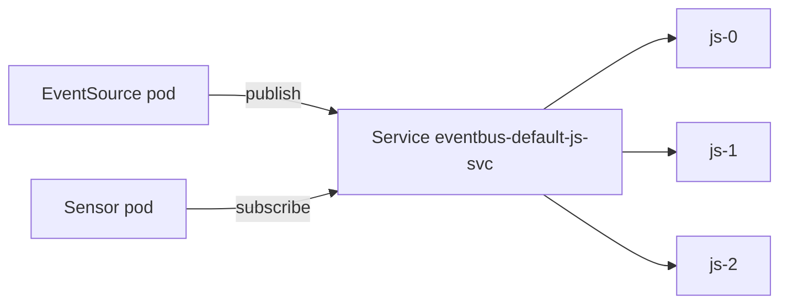

# The Bus In The Cluster

An EventSource publishes an event, and a Sensor consumes it, but the two never talk to each other. Something has to hold the event between the two moments, and it has to survive the restart of either side. That something is the EventBus. This part creates one and looks at everything the controller builds for it, because every later question about lost or late events starts with these objects.

The playground has no EventBus. You create it here.

## One object, one message service

An EventBus is a namespaced custom resource, and its short name is `eb`. A namespace needs one before an EventSource or a Sensor in it can work. The common practice is one bus named `default` in each namespace. The EventSource and Sensor objects look for a bus with that name, unless their spec has the field `eventBusName`, which names another bus in the same namespace.

The type of the message service is chosen by one of the keys under `spec`: `jetstream`, `nats`, `kafka` or `jetstreamExotic`. The `jetstream` key asks the controller to install a NATS server with JetStream enabled, and it is the type used in this course. Save this as `eventbus.yaml`:

```yaml
apiVersion: argoproj.io/v1alpha1
kind: EventBus
metadata:
  name: default
  namespace: starfleet
spec:
  jetstream:
    version: 2.10.10
    replicas: 3
```

The `version` is a NATS server version. The list of versions that the controller can install comes from its own configuration. The field `replicas` is the number of server pods. When it is left out, the controller uses three, and three is the value to use for a real bus, because JetStream replicates the stream across the pods and needs a majority of them to be up.

<!-- astrona:playground:renew -->

Apply the file and wait until the controller reports the bus as deployed:

```sh
kubectl apply -f eventbus.yaml
kubectl -n starfleet wait --for=condition=Deployed eventbus/default --timeout=300s
```

The condition `Deployed` means that the controller created the objects. The pods may still need a short time to start, so check them too:

```sh
kubectl -n starfleet get eb
kubectl -n starfleet get pods
```

The listing shows the bus, and three pods named `eventbus-default-js-0`, `eventbus-default-js-1` and `eventbus-default-js-2` appear one after another. A StatefulSet starts its pods in order, so the third pod is ready last.

## What the controller builds

The controller turns the EventBus into five kinds of objects. Every name has the form `eventbus-<name>-js` plus a suffix, where `<name>` is the name of the bus:

| Object | Name for the bus `default` | Purpose |
| --- | --- | --- |
| StatefulSet | `eventbus-default-js` | The server pods |
| Service | `eventbus-default-js-svc` | A headless Service (no cluster IP) with the ports `4222` for clients, `6222` for the cluster, `8222` for monitoring and a metrics port. Each pod has a stable name below it |
| ConfigMap | `eventbus-default-js-config` | The server configuration file `nats-js.conf` |
| Secret | `eventbus-default-js-server` | Keys for the server, including the key that encrypts the stored data |
| Secret | `eventbus-default-js-client-auth` | The credentials that EventSources and Sensors use to connect |

List them to confirm the names:

```sh
kubectl -n starfleet get statefulsets,services,configmaps,secrets | grep eventbus-default
```

Each server pod has three containers: `main` for the NATS server, `reloader` for the process that reloads the configuration when the ConfigMap changes, and `metrics` for the exporter that serves Prometheus metrics. Print the names of the containers of the first pod:

```sh
kubectl -n starfleet get pod eventbus-default-js-0 -o jsonpath='{.spec.containers[*].name}{"\n"}'
```

The output is `main reloader metrics`.



The diagram shows that clients talk only to the Service, and the three server pods replicate the stored events among themselves.

## How a client finds the bus

The controller writes the final connection settings into the status of the bus. Read the address:

```sh
kubectl -n starfleet get eb default -o jsonpath='{.status.config.jetstream.url}{"\n"}'
```

The address is `nats://eventbus-default-js-svc.starfleet.svc:4222`. The port `4222` is the NATS client port. When the controller creates the Deployment for an EventSource or a Sensor, it reads this status, gives the pod the address and the secret of the client credentials, and the pod connects. The traffic uses TLS, and the client authenticates with a password from the secret `eventbus-default-js-client-auth`. The upstream documentation states that TLS is on for the client connections and between the server nodes.

## An EventSource that names a missing bus

The field `eventBusName` makes the dependency visible. Save this as `eventsource-lost.yaml`. It names a bus that does not exist:

```yaml
apiVersion: argoproj.io/v1alpha1
kind: EventSource
metadata:
  name: lost
  namespace: starfleet
spec:
  eventBusName: harbor
  webhook:
    ping:
      port: "12000"
      endpoint: /ping
      method: POST
```

Apply it and look at the pods and at the status:

```sh
kubectl apply -f eventsource-lost.yaml
kubectl -n starfleet get pods -l eventsource-name=lost
kubectl -n starfleet get eventsource lost -o jsonpath='{.status.conditions}{"\n"}'
```

No pod appears for the EventSource, because the controller cannot find a bus named `harbor`, and the conditions in the status show that the EventSource is not deployed. Read the message in them. The fix is either to create a bus named `harbor` or to remove the field so that the EventSource uses `default`. Delete the object when you are done:

```sh
kubectl -n starfleet delete eventsource lost
```

## Common pitfalls

> [!WARNING]
> These mistakes cause most bus problems.
>
> - A new EventBus is not usable the moment the object exists. Wait for the condition `Deployed` and for all server pods to be ready before you create EventSources and Sensors.
> - EventSources and Sensors use the bus named `default` unless `eventBusName` says otherwise. A typo in `eventBusName` leaves the object without pods.
> - Do not edit the generated StatefulSet, ConfigMap or Secrets by hand. The controller owns them and writes them back from the EventBus spec.
> - Deleting the EventBus removes the server pods. Events that were stored on the bus without persistence are gone with them.
