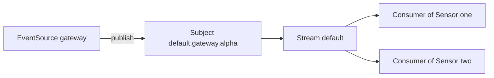

# Streams, Subjects And Delivery

An EventSource sends an event and moves on, and a Sensor reads it some milliseconds later or some minutes later. The EventBus must remember the event for that time, deliver it to every Sensor that asked for it, and forget it when it is no longer useful. JetStream does this with three ideas: a stream that stores messages, subjects that sort them, and consumers that remember how far each reader has come. This part names each idea, shows where Argo Events puts it, and sets the limits of the stream.

The playground has no EventBus. You create one with custom stream limits here.

## One stream, many subjects

The upstream documentation states how Argo Events uses JetStream. An EventBus has one stream, named `default`, with a single set of settings. Every event is published to a subject, and the subject name is `default.<eventsource name>.<event name>`. An event named `alpha` of an EventSource named `gateway` travels on the subject `default.gateway.alpha`. The subject is the address, and it is the same pair of names that a Sensor dependency holds. This is why a dependency needs both names.

A Sensor subscribes to the subjects of its dependencies with durable consumers. A consumer is the record that JetStream keeps for one reader: which messages it has been given and which of them it has acknowledged. Durable means that the record stays when the reader disconnects. A Sensor pod that restarts continues from its record. Two Sensors that depend on the same event have two consumers, so each one receives its own copy of the message.



The diagram shows that the stream stores each message once, and every Sensor has its own consumer that tracks its own position.

## Create a bus with stream limits

The field `streamConfig` of the bus is a YAML text. Its keys are properties of the stream. The upstream documentation lists the available fields, among them `maxBytes`, `maxMsgs`, `maxAge`, `replicas` and `duplicates`. The controller starts from a global default and merges the text on top of it, so a bus can set only what it wants to change. Save this as `eventbus.yaml`:

```yaml
apiVersion: argoproj.io/v1alpha1
kind: EventBus
metadata:
  name: default
  namespace: starfleet
spec:
  jetstream:
    version: 2.10.10
    replicas: 3
    streamConfig: |
      maxAge: 24h
      maxMsgs: 1000
```

<!-- astrona:playground:renew -->

Apply it and wait for the bus:

```sh
kubectl apply -f eventbus.yaml
kubectl -n starfleet wait --for=condition=Deployed eventbus/default --timeout=300s
```

The status of the bus holds the result of the merge. Print it:

```sh
kubectl -n starfleet get eb default -o jsonpath='{.status.config.jetstream.streamConfig}{"\n"}'
```

The output has the values `24h` for the age and `1000` for the number of messages, and it also has values that you did not write. The controller global configuration supplies them. In version 1.9.6 the defaults in the installation manifest are a maximum of 50000 messages, a maximum age of 168 hours, no byte limit, three stream replicas, a duplicates window of 300 seconds, retention by limits and discarding of the oldest messages. Keys may appear in lower case in the printed text, because the merge normalizes them.

The properties mean the following:

| Property | Effect |
| --- | --- |
| `maxMsgs` | The stream keeps at most this many messages. When it is full, the discard policy decides what goes |
| `maxAge` | A message older than this is removed, whether or not it was delivered |
| `maxBytes` | A limit on the total size, where `-1` means no limit |
| `replicas` | The number of copies of the stream, at most the number of server pods |
| `duplicates` | The time window in which a repeated message ID is refused |
| `retention` | `0` limits, `1` interest, `2` work queue. The default `0` keeps messages until a limit removes them |
| `discard` | `0` removes the oldest message when full, `1` refuses the new one |

A consequence of the limits is that the stream is a buffer with a size and a lifetime and not an archive. An event that nobody consumes for longer than `maxAge` is lost. A Sensor that is down for longer than that loses what it missed.

## The duplicates window

The `duplicates` property deserves its own explanation. Each published message has an ID. When the stream receives a message with the same ID as one it stored within the window, it drops the new message and does not store it twice. The default window is 300 seconds. A publisher that did not receive an acknowledgement can publish the same message again, and the window keeps that repeat from being stored as a second event.

The window is not a general filter for events that look alike. Two requests to a webhook are two different events with two different IDs, even when their bodies are identical, and both are delivered.

## Follow an event through the bus

Save this file as `pipeline.yaml`. It creates a webhook EventSource and a Sensor with a log trigger:

```yaml
apiVersion: argoproj.io/v1alpha1
kind: EventSource
metadata:
  name: gateway
  namespace: starfleet
spec:
  service:
    ports:
      - port: 12000
        targetPort: 12000
  webhook:
    alpha:
      port: "12000"
      endpoint: /alpha
      method: POST
---
apiVersion: argoproj.io/v1alpha1
kind: Sensor
metadata:
  name: reader
  namespace: starfleet
spec:
  dependencies:
    - name: alpha-dep
      eventSourceName: gateway
      eventName: alpha
  triggers:
    - template:
        name: print
        log: {}
```

Apply it and wait for both objects:

```sh
kubectl apply -f pipeline.yaml
kubectl -n starfleet wait --for=condition=Deployed eventsource/gateway --timeout=180s
kubectl -n starfleet wait --for=condition=Deployed sensor/reader --timeout=180s
```

Send an event and read the log of the Sensor:

```sh
kubectl -n starfleet exec shuttle -- curl -s -X POST -H 'Content-Type: application/json' -d '{"ship":"scout"}' http://gateway-eventsource-svc:12000/alpha
kubectl -n starfleet logs -l sensor-name=reader --tail=20
```

The log shows the event with the payload `scout`. The event went from the EventSource pod to the subject `default.gateway.alpha`, into the stream, and out to the consumer of the Sensor.

## A Sensor that is down

The durable consumer is what makes a Sensor restart harmless. Delete the Sensor pod, send an event while it is gone, and read the log again once the Deployment has started a new pod:

```sh
kubectl -n starfleet delete pod -l sensor-name=reader
kubectl -n starfleet exec shuttle -- curl -s -X POST -H 'Content-Type: application/json' -d '{"ship":"relay"}' http://gateway-eventsource-svc:12000/alpha
kubectl -n starfleet wait --for=condition=Ready pod -l sensor-name=reader --timeout=120s
kubectl -n starfleet logs -l sensor-name=reader --tail=20
```

The design of durable consumers is that the event published during the outage is delivered to the new pod after it connects. Look for `relay` in the new log. How fast it arrives depends on the time that the pod needs to start and to connect, so wait a few seconds and read the log again when it is not there yet.

## Common pitfalls

> [!WARNING]
> Stream limits are easy to forget until an event is missing.
>
> - `maxAge` and `maxMsgs` remove messages whether or not a Sensor has read them. A Sensor that is down for longer than `maxAge` never sees the events it missed.
> - The stream replicas cannot be more than the number of server pods. A bus with one pod and `replicas: 3` in `streamConfig` is a configuration error.
> - The `duplicates` window is about the message ID, not the body. Do not rely on it to drop repeated requests from a client.
> - The subject name is built from the EventSource name and the event name. Renaming either of them creates a new subject, and the Sensors that depend on the old names receive nothing.
