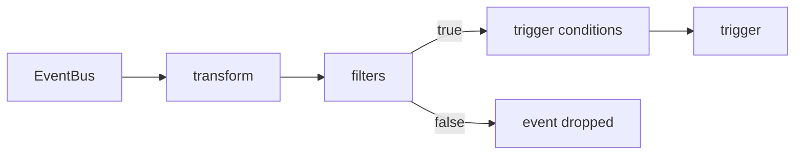

# Filters On A Dependency

A webhook EventSource publishes every request it receives, and the EventBus delivers every published event to every Sensor that depends on it. A Sensor that creates a Workflow for every event is rarely what a team wants. Most of the time only some events matter: a temperature above a limit, a message from one ship, a request that arrives inside working hours. A filter is the part of a dependency that decides, event by event, whether the Sensor accepts the event or drops it. This part shows what a filter can look at, how each of the five filter types decides, and how the results combine.

The EventBus `default` and the EventSource `telemetry` already exist in the playground. The EventSource has three events: `reading` on port `12000`, `alert` on port `13000` and `ack` on port `14000`. This part uses `reading`.

## What a filter can see

An event in the Sensor has two parts. The context holds fields about the event itself: the `type`, the `source`, the `subject`, the `datacontenttype`, an `id`, a `specversion` and a `time`. The data holds the content. For a webhook EventSource the data has two keys, `header` for the HTTP headers and `body` for the request body. When the request has the content type `application/json`, the body is the parsed JSON, so a request body of `{"sensor":"hull","temp":95}` is available at the path `body.temp`.

The filters live in the `filters` block of one dependency, so they belong to the dependency and not to the Sensor. Each dependency can have its own filters. A filter never changes an event. It only returns true or false, and an event that gets false is dropped for that dependency.



The diagram shows the place of the filters: they run on an event after the optional transformation and before the trigger conditions look at it. An event that fails the filters never counts as an arrived dependency.

## The data filter

The data filter compares a value in the event data with values that you list. It has these fields:

- `path` is the location of the value, written with dots. A path starts at the top of the data, so the request body starts with `body.`. The path syntax is the one of the gjson library, so a key can contain wildcards and an array item is addressed by its index.
- `type` is the JSON type to compare as: `string`, `number` or `bool`.
- `value` is a list of allowed values, always written as strings, even for numbers and booleans.
- `comparator` is one of `>=`, `>`, `=`, `!=`, `<` and `<=`. It is optional, and an empty comparator means `=`.
- `template` is an optional sprig template that changes the value before it is compared.

The three types compare differently. A `number` is parsed as a 64-bit floating point number, and the comparator decides. A `bool` has to be equal to one of the values. A `string` is different, and the difference causes many mistakes: every entry in `value` is a regular expression, and the filter passes when the expression matches anywhere in the string. The expression `hull` matches `hull`, and it also matches `hull-spare` and `overhull`. To match the whole string, write `^hull$`.

When the list holds more than one value, one match is enough. The list is an or. When a dependency has more than one data filter, all of them must pass, because the default operator between data filters is and. A path that does not exist counts as a failed filter, and the Sensor writes the missing path into a warning in its log.

## Try a data filter

Create a Sensor that accepts only readings of the sensor `hull` with a temperature above 80. The Sensor creates a Workflow that prints the temperature. Save this as `sensor-hull-watch.yaml`:

```yaml
apiVersion: argoproj.io/v1alpha1
kind: Sensor
metadata:
  name: hull-watch
  namespace: starfleet
spec:
  template:
    serviceAccountName: event-trigger
  dependencies:
    - name: reading-dep
      eventSourceName: telemetry
      eventName: reading
      filters:
        data:
          - path: body.sensor
            type: string
            value:
              - hull
          - path: body.temp
            type: number
            comparator: ">"
            value:
              - "80"
  triggers:
    - template:
        name: report-hull
        k8s:
          operation: create
          source:
            resource:
              apiVersion: argoproj.io/v1alpha1
              kind: Workflow
              metadata:
                generateName: hull-
              spec:
                serviceAccountName: workflow-runner
                entrypoint: report
                arguments:
                  parameters:
                    - name: text
                      value: unset
                templates:
                  - name: report
                    inputs:
                      parameters:
                        - name: text
                    container:
                      image: docker.io/library/busybox:1.37
                      command: [echo]
                      args: ["{{inputs.parameters.text}}"]
          parameters:
            - src:
                dependencyName: reading-dep
                dataKey: body.temp
              dest: spec.arguments.parameters.0.value
```

<!-- astrona:playground:renew -->

Apply it and wait until the Sensor and its pod are ready:

```sh
kubectl apply -f sensor-hull-watch.yaml
kubectl -n starfleet wait --for=condition=Deployed sensor/hull-watch --timeout=120s
kubectl -n starfleet wait --for=condition=Ready pod -l sensor-name=hull-watch --timeout=120s
```

The pod subscribes to the bus a short time after it is ready, and a Sensor only receives events that are published after it subscribes. Wait about ten seconds before you send the first event. Then define a helper that sends a JSON body to a port and a path of the EventSource Service and prints the HTTP status code:

```sh
send() {
  kubectl -n starfleet exec shuttle -- curl -s -o /dev/null -w '%{http_code}\n' \
    -X POST -H 'Content-Type: application/json' -d "$3" \
    "http://telemetry-eventsource-svc:$1/$2"
}
```

Send four readings. Only the first one satisfies both filters:

```sh
send 12000 reading '{"sensor":"hull","temp":95}'
send 12000 reading '{"sensor":"hull","temp":60}'
send 12000 reading '{"sensor":"cabin","temp":95}'
send 12000 reading '{"temp":95}'
```

Each request prints `200`, because the EventSource accepts every request. The filters act later, in the Sensor, so the status code says nothing about whether a Workflow starts. List the Workflows after a few seconds, with the temperature that each one received:

```sh
kubectl -n starfleet get workflows \
  -o jsonpath='{range .items[*]}{.metadata.name}{"\t"}{.spec.arguments.parameters[0].value}{"\n"}{end}'
```

One Workflow named `hull-` plus a random suffix exists, and its value is `95`. The three other events were dropped. Read the log of the Sensor to see why:

```sh
kubectl -n starfleet logs -l sensor-name=hull-watch --tail=40
```

The Sensor code writes the line `not interested in dependency reading-dep (didn't pass filter)` for each dropped event. The fourth event also produces a warning that says the event was discarded because of a filtering error, and the warning names the path `body.sensor` that does not exist. The upstream source writes a plain mismatch at debug level and a filtering error at warning level, so the warning appears only when the path or the expression itself is the problem.

## The regular expression trap

The Sensor above accepts a reading from `hull` and also from `hull-spare`, because the value `hull` is an unanchored regular expression. Check it:

```sh
send 12000 reading '{"sensor":"hull-spare","temp":99}'
```

After a few seconds the listing command shows a second Workflow with the value `99`. The event passed the filter although the sensor name is not `hull`. Open `sensor-hull-watch.yaml` and change the string value to `^hull$`, so the entry reads `- "^hull$"`. Apply the file again:

```sh
kubectl apply -f sensor-hull-watch.yaml
kubectl -n starfleet wait --for=condition=Ready pod -l sensor-name=hull-watch --timeout=120s
```

A change to a dependency makes the controller replace the Sensor pod. Wait until one pod is ready and about ten seconds longer, then send the same reading again. No new Workflow appears. The anchors turn the expression into an exact match.

## Combining filters

A dependency can have filters of several types at the same time. The types are the data filters, the expr filters, the script filter, the context filter and the time filter. The Sensor evaluates each type and then combines the results with the field `filtersLogicalOperator`, which sits on the dependency itself and not inside `filters`. The values are `and`, `or`, or an empty value that means `and`. The values are lower case. With `and`, every type that you configured must pass. With `or`, one passing type is enough, and a type that you did not configure counts as false.

Two more operators work inside a type. The field `dataLogicalOperator` inside `filters` decides how several data filters combine, and `exprLogicalOperator` does the same for several expr filters. The two levels are independent. This dependency accepts a reading when the hull is too hot or when the pressure is too low:

```yaml
dependencies:
  - name: reading-dep
    eventSourceName: telemetry
    eventName: reading
    filters:
      dataLogicalOperator: "or"
      data:
        - path: body.temp
          type: number
          comparator: ">"
          value:
            - "80"
        - path: body.pressure
          type: number
          comparator: "<"
          value:
            - "2"
```

A failing filter is not an error that stops the Sensor. Any error inside a filter, such as a missing path, counts as false. With `or`, the other filter can still pass the event, and the Sensor then writes the error into a warning that says the event passed with a filtering error.

## The other four filter types

The expr filter evaluates an expression with the govaluate library. Each entry has an `expr` and a list of `fields`. A field binds a `name` to a `path`, and the expression uses the names. The expression `temp > 80 && sensor == "hull"` with the fields `temp` at `body.temp` and `sensor` at `body.sensor` accepts hot hull readings. The expression language has arithmetic, comparison, `&&`, `||`, the regular expression operator `=~` and a ternary operator. The values are typed as JSON gives them, so a JSON number is a number in the expression.

The script filter holds a Lua script in `filters.script`. The Sensor gives the script the data as a table named `event`, so the temperature is `event.body.temp`. The script has to end with a `return`, and only the boolean `true` passes the event. The script `if event.body.temp > 80 then return true else return false end` is equal to the data filter above.

The context filter compares fields of the event context, and the fields are `type`, `subject`, `source` and `datacontenttype`. A field that you leave out is not checked. The values that a webhook EventSource sets are fixed: the `source` is the name of the EventSource, the `subject` is the name of the event, and the content type is `application/json`. A context filter therefore helps only when the same dependency could receive different values.

The time filter has a `start` and a `stop`, written as `HH:MM:SS` in UTC. It compares them with the time of the event. The start is inclusive and the stop is exclusive. When the stop is earlier than the start, the window crosses midnight, so `22:00:00` to `04:00:00` accepts events from ten in the evening until four in the morning.

The upstream documentation states that the Sensor evaluates the types in the order expr, data, context and time. It does not matter for the result, because the types are combined and not chained, but it explains why a failed expression can appear in the log before a failed data filter.

Every filter works on a single event. A filter cannot count events, compare two events or remember anything. It also cannot look at a second dependency. The rules that combine several dependencies are the subject of the trigger conditions.

## Common pitfalls

> [!WARNING]
> These mistakes make a Sensor drop events that it should accept.
>
> - A data filter path starts at the top of the event data, so a webhook body starts with `body.`. A path such as `temp` does not exist and the event is dropped.
> - A string value is a regular expression that matches anywhere. Use `^` and `$` when the whole value must be equal.
> - A number in `value` is written as a string, such as `"80"`. A value that cannot be parsed as a number is a filter error.
> - Logical operator values are lower case. A value such as `OR` is refused when the Sensor is created.
> - The controller replaces the Sensor pod when a dependency changes. Events that are sent while the new pod starts can be missed, so wait for the new pod before you test.
