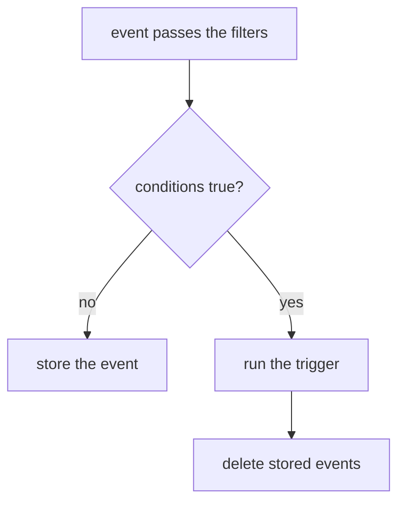

# Trigger Conditions And Reset

A Sensor often needs more than one event before it acts. A deployment may need a build event and an approval event. An alarm may need either of two sources. Filters cannot express this, because a filter sees one event of one dependency. The rule that combines dependencies belongs to the trigger, and it is called the trigger conditions. This part shows how a trigger decides, what the Sensor remembers between two events, and how to throw that memory away.

The EventBus `default` and the EventSource `telemetry` already exist in the playground. This part uses the events `alert` on port `13000` and `ack` on port `14000`.

## A Sensor with two dependencies

A dependency is one named entry in `spec.dependencies`. It points at one event of one EventSource, and its name is the label that the rest of the Sensor uses. Each trigger has an optional field `conditions`. It holds a boolean expression, written with the names of the dependencies. The trigger runs when the expression becomes true.

The expression language has the operators `&&` and `||` and parentheses. Dependency names can contain a dash. The expression `alert-dep && ack-dep` means that both dependencies must have delivered an event. The expression `(alert-dep || ack-dep) && approval-dep` means that approval is always needed, and either of the other two is enough. When a trigger has no `conditions` field, the Sensor uses the and of all dependencies of the Sensor.

Save this as `sensor-dock-gate.yaml`. The Sensor starts a Workflow when an alert and an acknowledgement have both arrived, and it prints the message of the alert:

```yaml
apiVersion: argoproj.io/v1alpha1
kind: Sensor
metadata:
  name: dock-gate
  namespace: starfleet
spec:
  template:
    serviceAccountName: event-trigger
  dependencies:
    - name: alert-dep
      eventSourceName: telemetry
      eventName: alert
    - name: ack-dep
      eventSourceName: telemetry
      eventName: ack
  triggers:
    - template:
        name: gate-report
        conditions: "alert-dep && ack-dep"
        k8s:
          operation: create
          source:
            resource:
              apiVersion: argoproj.io/v1alpha1
              kind: Workflow
              metadata:
                generateName: gate-
              spec:
                serviceAccountName: workflow-runner
                entrypoint: report
                arguments:
                  parameters:
                    - name: text
                      value: unset
                templates:
                  - name: report
                    inputs:
                      parameters:
                        - name: text
                    container:
                      image: docker.io/library/busybox:1.37
                      command: [echo]
                      args: ["{{inputs.parameters.text}}"]
          parameters:
            - src:
                dependencyName: alert-dep
                dataKey: body.msg
              dest: spec.arguments.parameters.0.value
```

<!-- astrona:playground:renew -->

Apply it and wait until the Sensor and its pod are ready:

```sh
kubectl apply -f sensor-dock-gate.yaml
kubectl -n starfleet wait --for=condition=Deployed sensor/dock-gate --timeout=120s
kubectl -n starfleet wait --for=condition=Ready pod -l sensor-name=dock-gate --timeout=120s
```

Wait about ten seconds so that the pod can subscribe to the bus. Define the helper that sends a JSON body, and a second helper that lists the Workflows of this Sensor with their message:

```sh
send() {
  kubectl -n starfleet exec shuttle -- curl -s -o /dev/null -w '%{http_code}\n' \
    -X POST -H 'Content-Type: application/json' -d "$3" \
    "http://telemetry-eventsource-svc:$1/$2"
}
list_gate_workflows() {
  kubectl -n starfleet get workflows \
    -o jsonpath='{range .items[*]}{.metadata.name}{"\t"}{.spec.arguments.parameters[0].value}{"\n"}{end}' | grep '^gate-'
}
```

## What the Sensor remembers

Send only the alert and look at the Workflows:

```sh
send 13000 alert '{"msg":"first"}'
list_gate_workflows
```

The request prints `200`. The listing prints nothing, and `grep` ends with a failure status because no line matches. The trigger did not run, because the expression `alert-dep && ack-dep` is still false. The Sensor did not forget the alert, though. It stored it.

The Sensor pod keeps one subscription for each pair of a trigger and a dependency. When an event passes the filters, the pod builds a table of which dependencies of this trigger have delivered, with the new one marked true. The pod evaluates the expression against that table. A false result stores the event in a key-value store of the EventBus, in a store that has the name of the Sensor, under the key `<trigger name>/<dependency name>`. A true result runs the trigger with the events and then deletes every stored event of this trigger.



The diagram shows the only two outcomes for an event that passed the filters: it waits in the store, or it completes the expression and the stored events are used up. Now send the acknowledgement:

```sh
send 14000 ack '{"note":"ok"}'
list_gate_workflows
```

After a few seconds the listing shows one Workflow named `gate-` plus a suffix, and the value is `first`. The stored alert and the new acknowledgement completed the expression, and the Sensor used both events.

## Latest event wins

The store holds one event for each dependency. A second event of the same dependency replaces the first one. Send two alerts and then one acknowledgement:

```sh
send 13000 alert '{"msg":"second"}'
send 13000 alert '{"msg":"third"}'
send 14000 ack '{"note":"ok"}'
list_gate_workflows
```

The listing shows two Workflows. The new one has the value `third`. The alert `second` was replaced before the acknowledgement arrived and never ran a trigger. The upstream documentation says it in short form: when the expression becomes true, the latest event of each dependency is used and the older ones are dropped.

An expression that contains only `||` and no `&&` needs no store. Each event that passes the filters makes the expression true at once, so the trigger runs once for each event. The Sensor code decides this by checking whether the expression text contains an ampersand.

## Change the rule

Change the line `conditions: "alert-dep && ack-dep"` in `sensor-dock-gate.yaml` to `conditions: "alert-dep || ack-dep"` and apply the file again:

```sh
kubectl apply -f sensor-dock-gate.yaml
kubectl -n starfleet wait --for=condition=Ready pod -l sensor-name=dock-gate --timeout=120s
```

Wait until one pod is ready and about ten seconds more. Then send an acknowledgement alone:

```sh
send 14000 ack '{"note":"ok"}'
list_gate_workflows
```

A third Workflow appears, and its value is `unset`. The trigger ran for the acknowledgement alone, and no alert took part. The parameter reads `body.msg` from the dependency `alert-dep`, and that dependency delivered no event, so the Sensor skips the parameter and the Workflow keeps the default value from its template. The upstream source states that this is not an error and that it happens with `||` conditions.

When the conditions of a trigger or the definition of a dependency change, the Sensor compares the new spec with the stored one when it starts. It deletes the stored events of the changed trigger or dependency, so an event that waited under the old rule does not complete the new one.

## Reset the stored events on a schedule

A stored event waits without a limit. Suppose both sources send one event each day. If the alert arrives today and the acknowledgement does not, the acknowledgement of tomorrow pairs with the alert of today. A reset prevents this. The field `conditionsReset` sits next to `conditions` and holds a list of criteria. The one criterion in version 1.9.6 is `byTime`, with a `cron` expression and an optional `timezone`.

The cron expression has five fields: minute, hour, day of the month, month and day of the week. It has no seconds field. At each time that matches, the Sensor deletes the stored events of the trigger. When the pod starts, it also deletes the stored events that are older than the last time the schedule would have matched.

The controller checks the expression and the timezone when it reads the Sensor. Add a six-field expression to see the check. Change the template in `sensor-dock-gate.yaml` so that it reads:

```yaml
    - template:
        name: gate-report
        conditions: "alert-dep && ack-dep"
        conditionsReset:
          - byTime:
              cron: "0 0 0 * * *"
              timezone: UTC
```

Apply the file and read the conditions in the status of the Sensor:

```sh
kubectl apply -f sensor-dock-gate.yaml
kubectl -n starfleet get sensor dock-gate \
  -o jsonpath='{range .status.conditions[*]}{.type}{"\t"}{.status}{"\t"}{.message}{"\n"}{end}'
```

The line for the type `TriggersProvided` has the status `False`, and its message contains `invalid cron expression "0 0 0 * * *"`. The controller refuses a Sensor that fails the check and leaves the running Deployment as it was. Replace the expression with `0 0 * * *`, which means every day at midnight in the timezone UTC, and apply again. The status then shows `TriggersProvided` as `True`.

## Names in the expression

The expression uses dependency names, not event names. The Sensor does not check this when it is created. The controller accepts an expression such as `alert && ack`, and the pod starts. The pod then looks up the names in the list of dependencies, writes the error `Dependency expression and dependency list do not match` for the first name that it cannot find, and the trigger never runs. The Sensor looks healthy and nothing happens, so the log of the Sensor pod is the place to look.

A pod holds one subscription for each trigger and dependency pair, so two triggers that name the same dependency each get a copy of every event and keep their own stored events. A trigger with the expression `alert-dep && ack-dep` and a trigger with `alert-dep` do not influence each other.

The two parts of a trigger decision are now clear. The filters of each dependency decide whether an event counts, and the conditions decide whether the counted events are enough. The stored events are the state between the two.

## Common pitfalls

> [!WARNING]
> These mistakes make a trigger run too often, too late or never.
>
> - The expression uses dependency names. Using the event name leaves the Sensor without a working trigger and without an error in its status.
> - Without `conditions`, a trigger needs all dependencies of the Sensor. A Sensor with two dependencies and no `conditions` never runs on one event.
> - The store keeps one event per dependency, and the latest event wins. Three alerts and one acknowledgement run the trigger once.
> - A stored event does not expire. Use `conditionsReset` when an old event must not pair with a new one.
> - A parameter that reads a dependency without an event keeps the template value when the trigger runs for an `||` condition.
