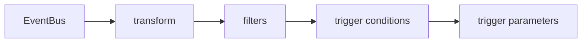

# Transforming Event Data

Events do not always arrive in the shape that a Sensor needs. A ship may report its name in lower case while the filter expects capitals. A body may carry many fields while the Workflow needs two of them. A transformation changes the data of an event inside the dependency, before any filter or parameter sees it. This part shows the two transformation languages, the place of the transformation in the pipeline, and how the changed data reaches the parameters of a trigger.

The EventBus `default` and the EventSource `telemetry` already exist in the playground. This part uses the event `reading` on port `12000`.

## Where a transformation runs

A transformation is the field `transform` on one dependency. It has two alternatives, `jq` and `script`. A dependency uses one of them, never both. When both are set, the Sensor applies only the `jq` command and ignores the script.

The Sensor applies the transformation to every event of that dependency as soon as the event arrives from the EventBus. The filters of the dependency run afterwards, so they see the transformed event. The trigger conditions and the trigger parameters work with the same transformed event.



Two limits follow from how the code works. First, the transformation sees only the event data and not the context. For a webhook EventSource the data is the object with the keys `header` and `body`, so a jq command starts with `.body` and a Lua script starts with `event.body`. The fields `type`, `source` and `subject` cannot be read or changed. Second, the transformation is not optional once it exists: when it fails, the Sensor discards the event.

## The jq transformation

The `jq` field holds a jq command. The Sensor evaluates it with the Go library gojq. The input is the event data as a JSON object. The command may produce any number of outputs, but the Sensor takes only the first one. The first output must be a JSON object. A number, a string, a list or `null` makes the transformation fail.

Some commands and what they do to the data `{"header":{...},"body":{"sensor":"hull","temp":95}}`:

- `.body.sensor |= ascii_upcase` changes the value of `sensor` to `HULL` and keeps everything else.
- `.body.temp *= 2` multiplies the temperature by two.
- `{body: {sensor: .body.sensor}}` builds a new object that holds only the sensor name. Without the outer braces the result would not be an object.
- `.body.sensor` returns a string, so the event is discarded.

A command that produces an object is always safe. A command that selects one field is not, so wrap the result in an object or use an update operator such as `|=` or `*=`.

## The Lua transformation

The `script` field holds a Lua script. The Sensor puts the event data into a global table named `event`. The script changes the table or builds a new one, and the last value that the script returns must be a table. A script that returns nothing, a string or a number fails the transformation, and so does a Lua error.

The script below does the same as the first jq command. Lua has no operator for upper case, so it calls the function `string.upper`:

```lua
event.body.sensor = string.upper(event.body.sensor)
return event
```

The Lua version is longer, but it can use conditions and loops. The jq version is shorter and works well for changes of single fields. The two languages treat numbers alike: a JSON number is a number in both.

## Try a transformation

Create a Sensor that upper-cases the sensor name, accepts only `HULL` and prints the name that it received. Save this as `sensor-hull-label.yaml`:

```yaml
apiVersion: argoproj.io/v1alpha1
kind: Sensor
metadata:
  name: hull-label
  namespace: starfleet
spec:
  template:
    serviceAccountName: event-trigger
  dependencies:
    - name: reading-dep
      eventSourceName: telemetry
      eventName: reading
      transform:
        jq: ".body.sensor |= ascii_upcase"
      filters:
        data:
          - path: body.sensor
            type: string
            value:
              - "^HULL$"
  triggers:
    - template:
        name: label-hull
        k8s:
          operation: create
          source:
            resource:
              apiVersion: argoproj.io/v1alpha1
              kind: Workflow
              metadata:
                generateName: label-
              spec:
                serviceAccountName: workflow-runner
                entrypoint: report
                arguments:
                  parameters:
                    - name: text
                      value: unset
                templates:
                  - name: report
                    inputs:
                      parameters:
                        - name: text
                    container:
                      image: docker.io/library/busybox:1.37
                      command: [echo]
                      args: ["{{inputs.parameters.text}}"]
          parameters:
            - src:
                dependencyName: reading-dep
                dataKey: body.sensor
              dest: spec.arguments.parameters.0.value
```

<!-- astrona:playground:renew -->

Apply it and wait until the Sensor and its pod are ready:

```sh
kubectl apply -f sensor-hull-label.yaml
kubectl -n starfleet wait --for=condition=Deployed sensor/hull-label --timeout=120s
kubectl -n starfleet wait --for=condition=Ready pod -l sensor-name=hull-label --timeout=120s
```

Wait about ten seconds so that the pod can subscribe to the bus. Define the helpers that send a body and list the Workflows of this Sensor with their value:

```sh
send() {
  kubectl -n starfleet exec shuttle -- curl -s -o /dev/null -w '%{http_code}\n' \
    -X POST -H 'Content-Type: application/json' -d "$3" \
    "http://telemetry-eventsource-svc:$1/$2"
}
list_label_workflows() {
  kubectl -n starfleet get workflows \
    -o jsonpath='{range .items[*]}{.metadata.name}{"\t"}{.spec.arguments.parameters[0].value}{"\n"}{end}' | grep '^label-'
}
```

Send a reading with a lower-case name, a reading with a name that is not `hull`, and a reading that is already in capitals:

```sh
send 12000 reading '{"sensor":"hull","temp":70}'
send 12000 reading '{"sensor":"cabin","temp":70}'
send 12000 reading '{"sensor":"HULL","temp":70}'
list_label_workflows
```

Each request prints `200`. The listing shows two Workflows named `label-` plus a suffix, and both have the value `HULL`. The first event passed the filter only because the transformation ran first: the original value `hull` does not match `^HULL$`, but the transformed value does. The second event became `CABIN` and was dropped. The third event was already in capitals, and the transformation left it as it was.

The value `HULL` in the Workflow shows the second result of the transformation. The parameter reads `body.sensor` from the transformed event, so the Workflow gets the changed value and never the original one. The original data of the event is no longer available in this Sensor once the transformation has run.

## Make the transformation fail

Change the line `jq: ".body.sensor |= ascii_upcase"` to `jq: ".body.sensor"`, apply the file, wait until the new pod is ready, and wait about ten seconds. Then send a reading and list the Workflows:

```sh
kubectl apply -f sensor-hull-label.yaml
kubectl -n starfleet wait --for=condition=Ready pod -l sensor-name=hull-label --timeout=120s
send 12000 reading '{"sensor":"HULL","temp":70}'
list_label_workflows
```

The listing shows the same two Workflows as before and no third one. The command `.body.sensor` returns the string `HULL`, and the transformation requires an object, so the Sensor discards the event. This happens even though the input already matches the filter. A failing transformation is the reason to test every new jq command or Lua script with an event before you rely on it.

## Reading the transformed data

The parameter field `dataKey` reads a path in the data of the event, and the data is the transformed data. After the transformation `{body: {sensor: .body.sensor}}` the path `body.temp` no longer exists. A parameter that reads a missing path stops the trigger with an error, unless the `src` of the parameter has a `value` that serves as a default. The filters follow the same rule, so a data filter on `body.temp` drops every event after a transformation that removed the field.

The key `dataTemplate` and the key `contextKey` of a parameter are the other two ways to read an event. A `contextKey` reads the context, which a transformation cannot change. A `dataTemplate` uses a Go template on the transformed data. Both are covered by the parameter documentation, and neither is needed for the lab of this module.

A transformation also runs for every event of the dependency, including the events that the filters would have dropped without it. A heavy script on a busy EventSource costs time for each event, so keep the script small and put cheap rejections into a filter.

## Common pitfalls

> [!WARNING]
> These mistakes make a Sensor drop events or read the wrong data.
>
> - The transformation runs before the filters. A filter that expects the original value fails on the transformed value.
> - A jq command must produce an object as its first output. A command that selects a single field returns a string or a number and discards the event.
> - A Lua script must return a table. Forgetting the `return` line fails the transformation.
> - Only the event data is available. The context fields cannot be read or changed.
> - A dependency uses either `jq` or `script`. When both are set, only `jq` runs.
