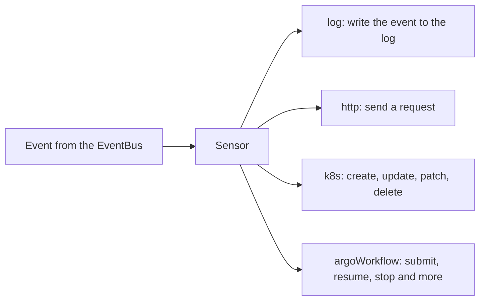

# Other Trigger Types

A Sensor that only creates Workflows is a narrow tool. Events also have to reach services that do not run on Argo Workflows, change an existing object, or only need to be written down for a person to read. Argo Events handles this with more than one trigger type. The Sensor keeps the same shape, and only the block under `template` changes. This part covers the four types that need no outside account: the HTTP trigger, the log trigger, the Kubernetes trigger with all four operations, and the Argo Workflows trigger with its eight operations.

The playground starts with a default EventBus, a small service called `beacon` that receives requests, and a webhook EventSource called `gate`. You write the Sensors that point triggers at them.

## One trigger, one template

Every entry in `spec.triggers` of a Sensor has a `template`, and the template has a unique `name`. Under the name, exactly one block describes what to run: `k8s`, `argoWorkflow`, `http`, `log`, and others for outside systems such as AWS Lambda, Kafka, NATS, Slack, OpenWhisk and email. The Sensor controller checks each block when it reconciles the Sensor. A template with a block that fails the check keeps the whole Sensor from being deployed. The trigger name must be unique inside the Sensor, because the Sensor uses it for the connection to the bus and for its logs.



The diagram shows that one Sensor can hold several triggers and that each trigger picks its own type. A Sensor with two triggers runs both for every event that satisfies its dependencies.

## The service that receives requests

The HTTP trigger needs a server to call. This one is small. It is a pod that runs the `httpd` program of BusyBox with two CGI scripts, which are programs that the server runs once for each request. The script `hook` checks the header `X-Fleet-Token` and writes every request into a file. It answers `403` when the token is not `nova`, so a request without the header is easy to see. The script `dead` only stores the body of the request. Two extra rules make some bodies fail on purpose: a body that contains `poison` always gets `503`, and a body that contains `flaky` gets `503` for the first two attempts and `200` from the third. A body without either word gets `200`.

The playground starts with this service already running in `starfleet`. It is shown here so that you can read what it does:

```yaml
apiVersion: v1
kind: ConfigMap
metadata:
  name: beacon-cgi
  namespace: starfleet
data:
  hook: |
    #!/bin/sh
    body=$(dd bs=1 count="${CONTENT_LENGTH:-0}" 2>/dev/null)
    mkdir -p /tmp/state
    reply() {
      printf 'Status: %s\r\nContent-Type: text/plain\r\n\r\n%s\n' "$1" "$2"
      echo "$(date +%T) $1 $body" >> /tmp/state/requests.log
    }
    if [ "${HTTP_X_FLEET_TOKEN:-}" != "nova" ]; then
      reply "403 Forbidden" "token missing"; exit 0
    fi
    case "$body" in
      *poison*) reply "503 Service Unavailable" "poison"; exit 0 ;;
      *flaky*)
        echo "$body" >> /tmp/state/attempts.log
        n=$(grep -cxF -- "$body" /tmp/state/attempts.log)
        if [ "$n" -lt 3 ]; then reply "503 Service Unavailable" "try again"; exit 0; fi ;;
    esac
    echo "$body" >> /tmp/state/accepted.log
    reply "200 OK" "accepted"
  dead: |
    #!/bin/sh
    body=$(dd bs=1 count="${CONTENT_LENGTH:-0}" 2>/dev/null)
    mkdir -p /tmp/state
    echo "$body" >> /tmp/state/dead.log
    printf 'Status: 200 OK\r\nContent-Type: text/plain\r\n\r\nstored\n'
---
apiVersion: v1
kind: Pod
metadata:
  name: beacon
  namespace: starfleet
  labels:
    app: beacon
spec:
  containers:
    - name: httpd
      image: docker.io/library/busybox:1.37
      command: [sh, -c]
      args:
        - mkdir -p /www/cgi-bin /tmp/state && cp /scripts/hook /scripts/dead /www/cgi-bin/ && chmod 755 /www/cgi-bin/hook /www/cgi-bin/dead && exec httpd -f -vv -p 8080 -h /www
      ports:
        - containerPort: 8080
      readinessProbe:
        tcpSocket:
          port: 8080
      volumeMounts:
        - name: scripts
          mountPath: /scripts
  volumes:
    - name: scripts
      configMap:
        name: beacon-cgi
---
apiVersion: v1
kind: Service
metadata:
  name: beacon
  namespace: starfleet
spec:
  selector:
    app: beacon
  ports:
    - port: 8080
      targetPort: 8080
```

The Service `beacon` answers at `http://beacon.starfleet.svc:8080` from inside the cluster. The two scripts are at the paths `/cgi-bin/hook` and `/cgi-bin/dead`.

## The HTTP trigger

The `http` block holds the request that the Sensor sends. The field names below come from the `HTTPTrigger` type of version 1.9.6.

- `url` is the full address of the request. It is required.
- `method` is the HTTP method. The default is `POST`. The controller accepts only `GET`, `DELETE`, `PATCH`, `POST` and `PUT`.
- `payload` is a list of parameters. Each one has a `src` that points at a value of an event and a `dest` that names a key in the JSON body of the request. The Sensor builds the body from these pairs.
- `headers` is a map of header names to values. `secureHeaders` reads a header value from a Secret or a ConfigMap, and `basicAuth` reads a user name and password from Secrets.
- `timeout` is the time limit of the request in seconds. The default is 60.
- `tls` sets the client certificate settings. `parameters` changes fields of the trigger itself, such as the `url`, from event data.

A `src` has the key `dependencyName` and one of `dataKey` (a path into the event data, where the webhook body is under `body`), `contextKey` (a path into the event context), a template, or a fixed `value`. The next steps use both `dataKey` and `contextKey`.

## The log trigger

The `log` block has one optional field, `intervalSeconds`. The trigger writes each event that arrives as one line in the log of the Sensor pod, with the event data in the message and the dependency name and the event context in separate fields. With `intervalSeconds` set, the Sensor writes at most one line in that period. The upstream documentation states that the log trigger is for debugging and that it does not support parameterization. It never fails, because it only writes a log line.

## Run both triggers from one event

The EventSource `gate` is also part of the start state. It is a webhook EventSource with two events. The event `relay` is for the HTTP trigger and the event `board` is for the Kubernetes trigger further down:

```yaml
apiVersion: argoproj.io/v1alpha1
kind: EventSource
metadata:
  name: gate
  namespace: starfleet
spec:
  service:
    ports:
      - port: 12000
        targetPort: 12000
      - port: 13000
        targetPort: 13000
  webhook:
    relay:
      port: "12000"
      endpoint: /relay
      method: POST
    board:
      port: "13000"
      endpoint: /board
      method: POST
```

<!-- astrona:playground:renew -->

Save this as `relay.yaml`. The Sensor has two triggers on the same dependency: a log trigger and an HTTP trigger that sends the field `id` of the request body and the name of the event:

```yaml
apiVersion: argoproj.io/v1alpha1
kind: Sensor
metadata:
  name: relay
  namespace: starfleet
spec:
  dependencies:
    - name: relay-dep
      eventSourceName: gate
      eventName: relay
  triggers:
    - template:
        name: print-event
        log: {}
    - template:
        name: notify-beacon
        http:
          url: http://beacon.starfleet.svc:8080/cgi-bin/hook
          method: POST
          headers:
            X-Fleet-Token: nova
            Content-Type: application/json
          payload:
            - src:
                dependencyName: relay-dep
                dataKey: body.id
              dest: id
            - src:
                dependencyName: relay-dep
                contextKey: subject
              dest: event
```

Apply the Sensor and wait until its pod is ready:

```sh
kubectl apply -f relay.yaml
kubectl -n starfleet wait --for=condition=Deployed sensor/relay --timeout=180s
kubectl -n starfleet wait --for=condition=Ready pod -l sensor-name=relay --timeout=180s
```

Send an event, wait a few seconds, and read the three places where it left a trace:

```sh
kubectl -n starfleet exec shuttle -- curl -s -X POST -H 'Content-Type: application/json' -d '{"id":"scout-1"}' http://gate-eventsource-svc:12000/relay
kubectl -n starfleet logs -l sensor-name=relay --tail=20
kubectl -n starfleet exec beacon -- cat /tmp/state/requests.log
kubectl -n starfleet exec beacon -- cat /tmp/state/accepted.log
```

The Sensor log has a line from the log trigger with the request body in its message and the field `dependencyName` set to `relay-dep`. The file `requests.log` has one line with a time, the status `200 OK` and a JSON body that holds `"id":"scout-1"` and `"event":"relay"`. The file `accepted.log` has the same body. The exact time stamps depend on your run.

## The Kubernetes trigger and its operations

The `k8s` block takes a `source` with a full object under `resource`, an `operation`, optional `parameters`, a `patchStrategy` and a flag `liveObject`. The operations in version 1.9.6 behave as follows, from the source code of the trigger:

| Operation | What the Sensor does |
| --- | --- |
| `create` (the default) | Creates the object and adds the labels `events.argoproj.io/sensor`, `events.argoproj.io/trigger` and `events.argoproj.io/action-timestamp` |
| `update` | Reads the object by name. If it does not exist, it creates it. Otherwise it merges the new fields over the old object and sends an update |
| `patch` | Reads the object by name. If it does not exist, it creates it. Otherwise it sends a patch with the whole resource as the body |
| `delete` | Reads the object by name. If it exists, it deletes it. If not, it does nothing and counts as a success |

For `patch`, the field `patchStrategy` selects the patch type. The allowed values in the API comments are `application/json-patch+json`, `application/merge-patch+json`, `application/strategic-merge-patch+json` and `application/apply-patch+yaml`. The default is `application/merge-patch+json`. The flag `liveObject` is valid only for `update`. It makes the Sensor fetch the current object from the cluster, and it needs `apiVersion`, `kind`, `name` and `namespace` in the resource. When the resource has no namespace, the Sensor uses its own.

The Sensor pod uses its service account for these calls, so the account needs a verb for each step. The operation `patch` needs `get` and `patch`. Save this as `board-rbac.yaml`:

```yaml
apiVersion: rbac.authorization.k8s.io/v1
kind: Role
metadata:
  name: event-trigger-config
  namespace: starfleet
rules:
  - apiGroups: [""]
    resources: ["configmaps"]
    verbs: ["get", "create", "update", "patch", "delete"]
---
apiVersion: rbac.authorization.k8s.io/v1
kind: RoleBinding
metadata:
  name: event-trigger-config
  namespace: starfleet
roleRef:
  apiGroup: rbac.authorization.k8s.io
  kind: Role
  name: event-trigger-config
subjects:
  - kind: ServiceAccount
    name: event-trigger
    namespace: starfleet
```

Save this as `board.yaml`. The ConfigMap `fleet-board` holds a status, and the Sensor `board` patches that status with the value from the request:

```yaml
apiVersion: v1
kind: ConfigMap
metadata:
  name: fleet-board
  namespace: starfleet
data:
  status: idle
---
apiVersion: argoproj.io/v1alpha1
kind: Sensor
metadata:
  name: board
  namespace: starfleet
spec:
  template:
    serviceAccountName: event-trigger
  dependencies:
    - name: board-dep
      eventSourceName: gate
      eventName: board
  triggers:
    - template:
        name: set-status
        k8s:
          operation: patch
          source:
            resource:
              apiVersion: v1
              kind: ConfigMap
              metadata:
                name: fleet-board
              data:
                status: unset
          parameters:
            - src:
                dependencyName: board-dep
                dataKey: body.status
              dest: data.status
```

Apply both files, wait, send an event and read the ConfigMap:

```sh
kubectl apply -f board-rbac.yaml -f board.yaml
kubectl -n starfleet wait --for=condition=Deployed sensor/board --timeout=180s
kubectl -n starfleet wait --for=condition=Ready pod -l sensor-name=board --timeout=180s
kubectl -n starfleet exec shuttle -- curl -s -X POST -H 'Content-Type: application/json' -d '{"status":"docked"}' http://gate-eventsource-svc:13000/board
kubectl -n starfleet get configmap fleet-board -o jsonpath='{.data.status}{"\n"}'
```

After a few seconds the command prints `docked` instead of `idle`. The patch ran with the default merge patch, so only `data.status` changed.

## The Argo Workflows trigger

The `argoWorkflow` block works on Workflow objects. Its `operation` has eight values: `submit`, `submit-from`, `resubmit`, `resume`, `retry`, `suspend`, `terminate` and `stop`. The Sensor does not call the Kubernetes API directly for these. It runs the `argo` command-line program that is inside the Sensor image, with the namespace and the operation, and it appends the strings of the field `args` to the command. For every operation except `submit`, the resource must have a `metadata.name`, because the command acts on an existing Workflow. For `submit-from`, the kind of the resource must be `CronWorkflow` or `WorkflowTemplate`.

This is a Sensor trigger that resumes a suspended Workflow named `orbit-check`. It is shown only to read the shape, and the lab does not apply it:

```yaml
triggers:
  - template:
      name: resume-orbit-check
      argoWorkflow:
        operation: resume
        source:
          resource:
            apiVersion: argoproj.io/v1alpha1
            kind: Workflow
            metadata:
              name: orbit-check
```

The version 1.9.6 validation code accepts only the eight names above, and an empty `operation` is rejected, so write the operation in every `argoWorkflow` trigger. After a `submit`, the Sensor lists the Workflows with its labels to find the new one, and for the other operations it reads the Workflow by name. The service account of the Sensor therefore needs `get` and `list` on Workflows in addition to the verbs that the `argo` command uses.

You now know the trigger types and where each one gets its input. A trigger can still fail, for example when the service answers with an error or the account lacks a verb, and the Sensor must decide what a failure is. That decision belongs to the trigger policy.

## Common pitfalls

> [!WARNING]
> Check each trigger against what it really needs.
>
> - The operation `patch` needs the verbs `get` and `patch` on the object. The account `event-trigger` has only `create` on Workflows until you add a Role, and a missing verb shows up as an error in the Sensor log while the Sensor stays deployed.
> - A webhook body is under `body` in the event data. A `dataKey` of `id` finds nothing, and `body.id` finds the value.
> - The log trigger has no parameterization and never fails, so a log line proves only that the event arrived.
> - The Sensor does not know what a header means. A wrong or missing header name does not stop the Sensor, because the service decides and the Sensor only sees the status code.
