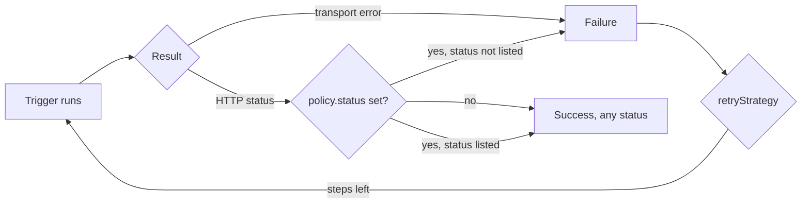

# Trigger Policy And Retry

A trigger runs, and then somebody has to decide whether it worked. For a Sensor that decision is not obvious. An HTTP request that returns `503` has reached its destination and received an answer. A Workflow that was created and then ended in `Failed` was created correctly. This part covers the two settings that define success and failure, the `policy` of a trigger and its `retryStrategy`, and it shows by experiment which failures the Sensor sees and which it does not see.

The playground starts with the default EventBus, the service `beacon` and the EventSource `gate`. The service `beacon` answers `503` for every body that contains `poison`, and for a body that contains `flaky` until it has seen the same body three times. It checks the header `X-Fleet-Token` and records every request in `/tmp/state/requests.log`, every accepted body in `accepted.log` and every body sent to its second endpoint in `dead.log`. The EventSource `gate` has the webhook events `relay` on port 12000 and `board` on port 13000.

## What the Sensor counts as a failure

Every trigger has a result of success or failure, and three settings shape it.

- The `policy` decides which responses and which resource states count as a failure. The field `policy.status` applies to HTTP triggers. The field `policy.k8s` applies to triggers that create Kubernetes objects, which includes the `argoWorkflow` trigger.
- The `retryStrategy` decides how often the Sensor repeats a trigger that failed, and how long it waits between the attempts.
- The field `atLeastOnce` decides whether the Sensor waits for the trigger and sees its result at all. This part shows its effect in one step.



The diagram shows the path of one HTTP trigger. A transport error, such as a refused connection, always fails. Without a `policy.status`, any response status is a success, and with one, only the listed statuses are.

## An HTTP trigger without a policy

Save this as `retry.yaml`. It is an HTTP trigger that sends the field `id` of the request body to the beacon:

```yaml
apiVersion: argoproj.io/v1alpha1
kind: Sensor
metadata:
  name: retry
  namespace: starfleet
spec:
  dependencies:
    - name: relay-dep
      eventSourceName: gate
      eventName: relay
  triggers:
    - template:
        name: notify-beacon
        http:
          url: http://beacon.starfleet.svc:8080/cgi-bin/hook
          method: POST
          headers:
            X-Fleet-Token: nova
            Content-Type: application/json
          payload:
            - src:
                dependencyName: relay-dep
                dataKey: body.id
              dest: id
```

<!-- astrona:playground:renew -->

Apply it and wait for the pod:

```sh
kubectl apply -f retry.yaml
kubectl -n starfleet rollout status deployment -l sensor-name=retry --timeout=180s
```

Send a body with the word `poison`. The beacon answers every such body with `503`:

```sh
kubectl -n starfleet exec shuttle -- curl -s -X POST -H 'Content-Type: application/json' -d '{"id":"poison-a1"}' http://gate-eventsource-svc:12000/relay
sleep 5
kubectl -n starfleet exec beacon -- grep -c poison-a1 /tmp/state/requests.log
kubectl -n starfleet logs -l sensor-name=retry --tail=30 | grep -c 'Successfully processed trigger'
```

The first command prints `1`, because the beacon received one request. The second prints `1` as well. The Sensor logged that it processed the trigger successfully, although the beacon answered with `503`. With no `policy.status`, version 1.9.6 does not look at the status of the response at all, and only a failure to talk to the service counts as an error.

## policy.status

Add a `policy` with a list of allowed statuses to the trigger. Change the trigger in `retry.yaml` so that the template looks like this, and keep the rest of the file:

```yaml
    - template:
        name: notify-beacon
        http:
          url: http://beacon.starfleet.svc:8080/cgi-bin/hook
          method: POST
          headers:
            X-Fleet-Token: nova
            Content-Type: application/json
          payload:
            - src:
                dependencyName: relay-dep
                dataKey: body.id
              dest: id
      policy:
        status:
          allow:
            - 200
```

The `policy` sits next to `template` and not inside it. This matters because the Sensor definition keeps fields that the schema does not know without an error, so a `policy` under `template` is accepted and then has no effect. The list `allow` takes numbers. A response with a status that is not in the list fails with the message `policy application resulted in failure. http response status 503 is not allowed`.

Apply it and send a body that makes the beacon fail twice before it accepts:

```sh
kubectl apply -f retry.yaml
kubectl -n starfleet rollout status deployment -l sensor-name=retry --timeout=180s
kubectl -n starfleet exec shuttle -- curl -s -X POST -H 'Content-Type: application/json' -d '{"id":"flaky-b1"}' http://gate-eventsource-svc:12000/relay
sleep 10
kubectl -n starfleet exec beacon -- grep -c flaky-b1 /tmp/state/requests.log
kubectl -n starfleet logs -l sensor-name=retry --tail=30 | grep -i 'not allowed\|Failed to execute'
```

The beacon count is still `1`. The Sensor log now has a line with `Failed to execute a trigger` and the error message about the status. The Sensor noticed the failure and wrote it down, and then it did nothing else. A `policy` alone defines a failure but does not repeat anything.

## retryStrategy

The `retryStrategy` is a sibling of `template` and `policy`. It has the same fields as the backoff of the policy:

- `steps` is the number of attempts in total, including the first one. A value of `0` means the default of `5`.
- `duration` is the first wait between two attempts, as a string such as `1s`, or as an integer in nanoseconds.
- `factor` multiplies the wait after every attempt. It is a number and not a string, and the default is `1`.
- `jitter` adds a random part to every wait, as a fraction of the wait. It is a number.

For `steps: 3`, the Sensor makes three attempts and waits twice. With `duration: 1s` and `factor: 2`, the two waits are about one and two seconds.

Without a `retryStrategy`, the Sensor makes exactly one attempt. Add this field next to `policy` in the trigger, which makes the trigger end like this:

```yaml
      policy:
        status:
          allow:
            - 200
      retryStrategy:
        steps: 3
        duration: 1s
```

Apply it and send a new flaky body:

```sh
kubectl apply -f retry.yaml
kubectl -n starfleet rollout status deployment -l sensor-name=retry --timeout=180s
kubectl -n starfleet exec shuttle -- curl -s -X POST -H 'Content-Type: application/json' -d '{"id":"flaky-c1"}' http://gate-eventsource-svc:12000/relay
sleep 10
kubectl -n starfleet exec beacon -- grep -c flaky-c1 /tmp/state/requests.log
```

The count is still `1`. The Sensor does not repeat the trigger, and the reason is not in the retry settings. Without `atLeastOnce`, the Sensor starts the trigger in the background and treats it as finished at once, so a failure is written to the log and never reaches the retry. This is the most common wrong fix in practice. Set `atLeastOnce: true` on the trigger, which puts the field next to `retryStrategy`:

```yaml
      atLeastOnce: true
      retryStrategy:
        steps: 3
        duration: 1s
```

Apply it and send another body:

```sh
kubectl apply -f retry.yaml
kubectl -n starfleet rollout status deployment -l sensor-name=retry --timeout=180s
kubectl -n starfleet exec shuttle -- curl -s -X POST -H 'Content-Type: application/json' -d '{"id":"flaky-d1"}' http://gate-eventsource-svc:12000/relay
sleep 10
kubectl -n starfleet exec beacon -- grep flaky-d1 /tmp/state/requests.log | awk '{print $2}'
kubectl -n starfleet exec beacon -- grep -c flaky-d1 /tmp/state/accepted.log
```

The first command prints `503`, `503` and `200` on three lines, and the second prints `1`. The Sensor made three attempts, and the third was the first the beacon accepted. The retry stops at the first success, so a trigger that succeeds on the first attempt makes one request.

## policy.k8s

For a trigger that creates a Kubernetes object, success is not a response code. The object exists after the create call, and whether it worked is a state that appears later. The field `policy.k8s` describes that state with labels.

- `labels` is a map. The Sensor reads the object it created and checks that every listed label has the listed value.
- `backoff` is required. It has the fields `steps`, `duration`, `factor` and `jitter` and sets how often and how long the Sensor looks.
- `errorOnBackoffTimeout` decides what happens when the labels never match within the backoff. The default is `false`, and then the trigger counts as a success. With `true`, the trigger fails with the message `failed to determine status of the triggered resource. setting trigger state as failed`.

A Workflow carries the label `workflows.argoproj.io/phase`, which the Workflow controller sets. The Sensor needs the verb `get` on Workflows to read the label. The service account `event-trigger` has only `create`, so give it more. Save this as `watch-rbac.yaml`:

```yaml
apiVersion: rbac.authorization.k8s.io/v1
kind: Role
metadata:
  name: event-trigger-watch
  namespace: starfleet
rules:
  - apiGroups: ["argoproj.io"]
    resources: ["workflows"]
    verbs: ["get", "list"]
---
apiVersion: rbac.authorization.k8s.io/v1
kind: RoleBinding
metadata:
  name: event-trigger-watch
  namespace: starfleet
roleRef:
  apiGroup: rbac.authorization.k8s.io
  kind: Role
  name: event-trigger-watch
subjects:
  - kind: ServiceAccount
    name: event-trigger
    namespace: starfleet
```

Save this as `crash.yaml`. The Sensor creates a Workflow that always fails, and it asks for the phase `Succeeded` with a short backoff:

```yaml
apiVersion: argoproj.io/v1alpha1
kind: Sensor
metadata:
  name: crash
  namespace: starfleet
spec:
  template:
    serviceAccountName: event-trigger
  dependencies:
    - name: board-dep
      eventSourceName: gate
      eventName: board
  triggers:
    - template:
        name: run-crash
        k8s:
          operation: create
          source:
            resource:
              apiVersion: argoproj.io/v1alpha1
              kind: Workflow
              metadata:
                generateName: crash-
              spec:
                entrypoint: main
                serviceAccountName: workflow-runner
                templates:
                  - name: main
                    container:
                      image: docker.io/library/busybox:1.37
                      command: [sh, -c]
                      args: ["exit 1"]
      policy:
        k8s:
          labels:
            workflows.argoproj.io/phase: Succeeded
          backoff:
            steps: 4
            duration: 1s
            factor: 2
          errorOnBackoffTimeout: false
```

Apply both files and send an event to the `board` endpoint. With the flag `false`, the trigger counts as a success, although the Workflow fails:

```sh
kubectl apply -f watch-rbac.yaml -f crash.yaml
kubectl -n starfleet rollout status deployment -l sensor-name=crash --timeout=180s
kubectl -n starfleet exec shuttle -- curl -s -X POST -H 'Content-Type: application/json' -d '{"status":"x"}' http://gate-eventsource-svc:13000/board
sleep 25
kubectl -n starfleet logs -l sensor-name=crash --tail=40 | grep -c 'Successfully processed trigger'
```

The command prints `1`. The Sensor waited about seven seconds for the label, did not see `Succeeded`, and then gave up without calling it an error. Set `errorOnBackoffTimeout: true`, apply the file again, send one more event and read the log for the failure message:

```sh
sed -i.bak 's/errorOnBackoffTimeout: false/errorOnBackoffTimeout: true/' crash.yaml
kubectl apply -f crash.yaml
kubectl -n starfleet rollout status deployment -l sensor-name=crash --timeout=180s
kubectl -n starfleet exec shuttle -- curl -s -X POST -H 'Content-Type: application/json' -d '{"status":"y"}' http://gate-eventsource-svc:13000/board
sleep 25
kubectl -n starfleet logs -l sensor-name=crash --tail=40 | grep 'failed to determine status'
```

The log now has a line with the text `failed to determine status of the triggered resource. setting trigger state as failed`. The Workflow is the same, and only the setting changed how the Sensor judges it. The `argoWorkflow` trigger accepts the same `policy.k8s`, because it creates the Workflow through the same path.

## Common pitfalls

> [!WARNING]
> A policy or a retry that looks right can do nothing at all.
>
> - A trigger without `policy.status` treats every HTTP status as a success, including `500` and `503`.
> - A `retryStrategy` without `atLeastOnce: true` is never used, because the failure is only logged.
> - A `policy` placed inside `template` is accepted and ignored. It belongs next to `template`.
> - A `policy.k8s` without `errorOnBackoffTimeout: true` hides a Workflow that never reaches the wanted label, and the Sensor needs `get` on the object to read its labels.
> - The field `factor` and `jitter` are numbers. A quoted value such as `"2"` fails when the Sensor reads it.
