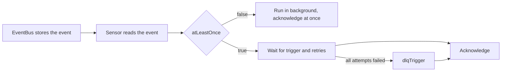

# Delivery Guarantees

A Sensor that retries is still not a system that guarantees delivery. Delivery has two sides. One side is how the event gets from the EventBus to the Sensor, and the other is how the Sensor makes sure that the action took place. This part covers the settings of a trigger that decide what happens when all attempts have failed, how fast the trigger may run, and how many old copies of the Sensor deployment are kept. It also states what the Sensor in version 1.9.6 does and does not promise, based on its source code.

The playground starts with the default EventBus, the service `beacon` and the EventSource `gate`. The service `beacon` answers `503` for every body that contains `poison`. It records every request in `/tmp/state/requests.log` and every accepted body in `accepted.log`, and the endpoint `/cgi-bin/dead` stores every body it receives in `dead.log`. The EventSource `gate` has the webhook event `relay` on port 12000.

## Two sides of delivery

On the way in, the EventSource publishes an event to the EventBus, which is JetStream, and the Sensor reads it with a durable consumer. JetStream stores the event until the Sensor acknowledges it. The Sensor keeps the identifiers of the events it has seen in memory and drops a repeated identifier, and the upstream documentation states that this cache keeps identifiers for five minutes. The Sensor acknowledges the message when it has finished handling it, and it does that whether the trigger succeeded or failed. A failed trigger therefore does not cause the bus to send the same event again.

On the way out, the Sensor runs the trigger. The field `atLeastOnce` decides whether the Sensor waits for the result. Without it, the Sensor starts the trigger in the background and moves on, so a failure is only a log line. With `atLeastOnce: true`, the Sensor waits for the trigger and its retries, and it acknowledges the message after that. When the Sensor pod stops in the middle of the wait, the message is not acknowledged, and the bus sends it again to the new pod.



The diagram shows that `atLeastOnce` is the switch between a trigger whose result the Sensor can act on and a trigger whose result it cannot. The setting is ignored when the EventBus is NATS, where the Sensor writes a warning. JetStream is the only bus that this course uses.

## dlqTrigger

A dead letter trigger is a second trigger that the Sensor runs when the first one has failed on every attempt. In the Sensor it is the field `dlqTrigger` of a trigger, and its type is a trigger of its own with a `template`, an optional `retryStrategy` and an `atLeastOnce` flag. The controller checks these rules, and a Sensor that breaks one is not deployed:

- The trigger that has a `dlqTrigger` must have `atLeastOnce: true`.
- The `dlqTrigger` must have `atLeastOnce: true` as well.
- A `dlqTrigger` cannot have a `dlqTrigger` of its own.

The reason for the first rule follows from the section above. The Sensor can only call the dead letter trigger when it sees the failure, and it sees the failure only when it waits.

Save this as `guard.yaml`. It has the dead letter trigger and leaves out the flag on the main trigger:

```yaml
apiVersion: argoproj.io/v1alpha1
kind: Sensor
metadata:
  name: guard
  namespace: starfleet
spec:
  dependencies:
    - name: relay-dep
      eventSourceName: gate
      eventName: relay
  triggers:
    - template:
        name: notify-beacon
        http:
          url: http://beacon.starfleet.svc:8080/cgi-bin/hook
          method: POST
          headers:
            X-Fleet-Token: nova
            Content-Type: application/json
          payload:
            - src:
                dependencyName: relay-dep
                dataKey: body.id
              dest: id
      policy:
        status:
          allow:
            - 200
      retryStrategy:
        steps: 3
        duration: 1s
      dlqTrigger:
        atLeastOnce: true
        template:
          name: park-message
          http:
            url: http://beacon.starfleet.svc:8080/cgi-bin/dead
            method: POST
            headers:
              Content-Type: application/json
            payload:
              - src:
                  dependencyName: relay-dep
                  dataKey: body.id
                dest: id
```

<!-- astrona:playground:renew -->

Apply it and read the conditions of the Sensor:

```sh
kubectl apply -f guard.yaml
sleep 5
kubectl -n starfleet get sensor guard -o jsonpath='{.status.conditions[?(@.type=="TriggersProvided")].status}{"\n"}'
kubectl -n starfleet get sensor guard -o jsonpath='{.status.conditions[?(@.type=="TriggersProvided")].message}{"\n"}'
```

The first command prints `False`. The second prints a message that contains `to use dlqTrigger, trigger.atLeastOnce must be set to true`. The Sensor object exists, but the controller did not deploy a pod for it, so it cannot send anything. Add the flag to the main trigger, next to `retryStrategy`:

```yaml
      atLeastOnce: true
      retryStrategy:
        steps: 3
        duration: 1s
```

Apply the file again and send a normal body and a body that the beacon always rejects:

```sh
kubectl apply -f guard.yaml
kubectl -n starfleet rollout status deployment -l sensor-name=guard --timeout=180s
kubectl -n starfleet exec shuttle -- curl -s -X POST -H 'Content-Type: application/json' -d '{"id":"cargo-1"}' http://gate-eventsource-svc:12000/relay
kubectl -n starfleet exec shuttle -- curl -s -X POST -H 'Content-Type: application/json' -d '{"id":"poison-1"}' http://gate-eventsource-svc:12000/relay
sleep 15
kubectl -n starfleet exec beacon -- grep -c cargo-1 /tmp/state/accepted.log
kubectl -n starfleet exec beacon -- grep -c poison-1 /tmp/state/requests.log
kubectl -n starfleet exec beacon -- grep -c poison-1 /tmp/state/dead.log
kubectl -n starfleet exec beacon -- grep -c poison-1 /tmp/state/accepted.log
```

The four commands print `1`, `3`, `1` and `0`. The normal body was accepted once. The rejected body reached the beacon three times, once for each attempt, and then the dead letter trigger sent it to the second endpoint, which stored it once. It was never accepted. The dead letter trigger is not a repair. It moves the failed message to a place where a person or another process can find it.

## rateLimit

The field `rateLimit` limits how often one trigger may run. It has a `requestsPerUnit` and a `unit` that is `Second`, `Minute` or `Hour`, and the default unit is `Second`. A trigger without it has no limit. The Sensor takes one token before every attempt to run the trigger, and a retry takes a token too. When no token is free, the Sensor waits until one is.

Delete the earlier Sensor and save this as `paced.yaml`:

```yaml
apiVersion: argoproj.io/v1alpha1
kind: Sensor
metadata:
  name: paced
  namespace: starfleet
spec:
  revisionHistoryLimit: 2
  dependencies:
    - name: relay-dep
      eventSourceName: gate
      eventName: relay
  triggers:
    - template:
        name: notify-beacon
        http:
          url: http://beacon.starfleet.svc:8080/cgi-bin/hook
          method: POST
          headers:
            X-Fleet-Token: nova
            Content-Type: application/json
          payload:
            - src:
                dependencyName: relay-dep
                dataKey: body.id
              dest: id
      rateLimit:
        unit: Minute
        requestsPerUnit: 1
```

The field `revisionHistoryLimit` sits directly under `spec`, because it belongs to the whole Sensor and not to one trigger. Apply the Sensor and send two events in a row:

```sh
kubectl -n starfleet delete sensor guard
kubectl apply -f paced.yaml
kubectl -n starfleet rollout status deployment -l sensor-name=paced --timeout=180s
kubectl -n starfleet exec shuttle -- curl -s -X POST -H 'Content-Type: application/json' -d '{"id":"pace-1"}' http://gate-eventsource-svc:12000/relay
kubectl -n starfleet exec shuttle -- curl -s -X POST -H 'Content-Type: application/json' -d '{"id":"pace-2"}' http://gate-eventsource-svc:12000/relay
sleep 10
kubectl -n starfleet exec beacon -- grep -c pace- /tmp/state/accepted.log
sleep 65
kubectl -n starfleet exec beacon -- grep -c pace- /tmp/state/accepted.log
```

The commands print `1` and then `2`. The first event ran at once. The second event waited for the next token, which the limit of one request per minute frees after about a minute.

## revisionHistoryLimit

The field `revisionHistoryLimit` of the Sensor spec is copied to the Deployment that the controller creates for the Sensor. The Deployment keeps that many old ReplicaSets, one for each earlier version of the pod template. Every change of a Sensor that changes the pod, such as a new trigger, creates a new ReplicaSet. A small value keeps the cluster tidy, and a larger one allows a rollback. Read it from the Deployment:

```sh
kubectl -n starfleet get deployment -l sensor-name=paced -o jsonpath='{.items[0].spec.revisionHistoryLimit}{"\n"}'
```

The command prints `2`.

## errorOnFailedRound

The Sensor spec also has a field `errorOnFailedRound`. The documentation of the field says that it marks the Sensor as being in an error state when a trigger round fails. The version 1.9.6 source code declares the field in the API types and in the generated schema, and no code of the Sensor or the controller reads it. Setting it therefore has no observable effect in this version. Do not rely on it for alerting. Use the failure messages in the Sensor log, the dead letter trigger and the conditions of the Sensor object instead.

## What is guaranteed

With JetStream, the Sensor offers at least once delivery of the action only when `atLeastOnce` is true. The bus does not repeat an event after the Sensor has acknowledged it, and the Sensor acknowledges it after the trigger and its retries, or after the dead letter trigger. A pod that stops during that time gets the event again, which can run the action a second time, so the service that receives it must handle a repeat. The five minute identifier cache removes repeats that arrive close together. The upstream documentation describes the combination as close to exactly once, and this course does not claim more than that.

## Common pitfalls

> [!WARNING]
> Delivery settings fail without an error unless every part is present.
>
> - A `dlqTrigger` needs `atLeastOnce: true` on both the trigger and the dead letter trigger. Without it the Sensor is not deployed and no message is sent.
> - A `retryStrategy` or `dlqTrigger` without a `policy.status` never fires for an HTTP trigger that gets a `503`, because that status counts as a success.
> - A `rateLimit` counts retries. A trigger with `steps: 5` and one request per minute needs about four minutes for one failing message.
> - The field `errorOnFailedRound` does nothing in version 1.9.6, and `revisionHistoryLimit` belongs directly under `spec`.
