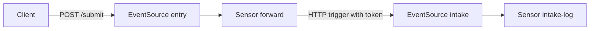

# Chaining Pipelines With The HTTP Trigger

One pipeline often has to start another. A front pipeline receives a request from outside, and a second pipeline, owned by another team or running in another namespace, does the next step. The HTTP trigger connects them: the Sensor of the first pipeline sends a request to the webhook EventSource of the second one. The second pipeline then treats it like any other event.

This part builds two pipelines in one namespace and joins them. It shows how the trigger sends a bearer token from a Secret, how it builds the body from the first event, and how the policy turns a refusal into a failure that the Sensor can see.

## The two pipelines

The first pipeline has an EventSource named `entry` with the event `submit`, and a Sensor named `forward`. The second pipeline has an EventSource named `intake` with the event `order`, protected by a bearer token, and a Sensor named `intake-log` that logs what arrives. The trigger of `forward` calls the Service of `intake`.



The diagram shows the chain. The arrow from `forward` to `intake` is a normal HTTP request, so the second pipeline cannot tell that the sender is a Sensor.

## Create the second pipeline

The token has two copies, because two objects use it in two forms. The EventSource `intake` reads the plain token. The trigger sends the header `Authorization: Bearer <token>`, so its Secret holds the whole header value. Save this as `secrets-chain.yaml`:

```yaml
apiVersion: v1
kind: Secret
metadata:
  name: intake-token
  namespace: starfleet
stringData:
  token: chain-7731
---
apiVersion: v1
kind: Secret
metadata:
  name: forward-header
  namespace: starfleet
stringData:
  authorization: Bearer chain-7731
```

<!-- astrona:playground:renew -->

Apply it:

```sh
kubectl apply -f secrets-chain.yaml
```

Save the second pipeline as `pipeline-intake.yaml`:

```yaml
apiVersion: argoproj.io/v1alpha1
kind: EventSource
metadata:
  name: intake
  namespace: starfleet
spec:
  service:
    ports:
      - port: 12000
        targetPort: 12000
  webhook:
    order:
      port: "12000"
      endpoint: /order
      method: POST
      authSecret:
        name: intake-token
        key: token
---
apiVersion: argoproj.io/v1alpha1
kind: Sensor
metadata:
  name: intake-log
  namespace: starfleet
spec:
  dependencies:
    - name: order-dep
      eventSourceName: intake
      eventName: order
  triggers:
    - template:
        name: print-order
        log: {}
```

Apply it and wait until both objects are deployed:

```sh
kubectl apply -f pipeline-intake.yaml
kubectl -n starfleet wait --for=condition=Deployed eventsource/intake --timeout=180s
kubectl -n starfleet wait --for=condition=Deployed sensor/intake-log --timeout=180s
```

## Create the first pipeline

The Sensor `forward` sends the request. Four fields of the `http` block matter here.

- `url` is the address of the Service of the second EventSource, with the port and the path of the event.
- `headers` sets the content type, so that the second EventSource reads the body as JSON.
- `secureHeaders` sets a header whose value comes from a Secret. The value never appears in the Sensor.
- `payload` builds the JSON body. Each entry copies a value from an event (`src`) into a key of the body (`dest`).

Save this as `pipeline-entry.yaml`:

```yaml
apiVersion: argoproj.io/v1alpha1
kind: EventSource
metadata:
  name: entry
  namespace: starfleet
spec:
  service:
    ports:
      - port: 12000
        targetPort: 12000
  webhook:
    submit:
      port: "12000"
      endpoint: /submit
      method: POST
---
apiVersion: argoproj.io/v1alpha1
kind: Sensor
metadata:
  name: forward
  namespace: starfleet
spec:
  dependencies:
    - name: submit-dep
      eventSourceName: entry
      eventName: submit
  triggers:
    - template:
        name: send-order
        http:
          url: http://intake-eventsource-svc.starfleet.svc:12000/order
          method: POST
          headers:
            Content-Type: application/json
          secureHeaders:
            - name: Authorization
              valueFrom:
                secretKeyRef:
                  name: forward-header
                  key: authorization
          payload:
            - src:
                dependencyName: submit-dep
                dataKey: body.item
              dest: item
        policy:
          status:
            allow:
              - 200
```

The `policy` at the end says that only the status `200` counts as success. Without it, the Sensor counts a response such as `403` as a success, because the request reached its destination.

Apply it:

```sh
kubectl apply -f pipeline-entry.yaml
kubectl -n starfleet wait --for=condition=Deployed eventsource/entry --timeout=180s
kubectl -n starfleet wait --for=condition=Deployed sensor/forward --timeout=180s
```

## Send a request through the chain

Send one request to the first EventSource, and then read the log of the second Sensor:

```sh
kubectl -n starfleet exec shuttle -- curl -s -o /dev/null -w '%{http_code}\n' -X POST \
  -H 'Content-Type: application/json' -d '{"item":"fuel"}' http://entry-eventsource-svc:12000/submit
kubectl -n starfleet logs -l sensor-name=intake-log --tail=20
```

The log of `intake-log` has an event with the body `{"item":"fuel"}`. The body was built by the trigger from the key `body.item` of the first event, and the token in the header was accepted by the second EventSource. The first request returned `200` as soon as the first EventSource accepted it, not after the second pipeline finished: the two pipelines are not tied together in time.

To see the refusal, change the value in `secrets-chain.yaml` for `forward-header` to `Bearer wrong`, apply the file and send the request again. The second EventSource refuses the request, the log of `intake-log` gets no new event, and the log of `forward` reports a failed trigger because `403` is not in the allowed list. Restore the right value afterwards.

## Other ways to authenticate

The `basicAuth` field of the HTTP trigger sends a user name and a password that it reads from two Secrets, and the `tls` field sets a client certificate for a service that needs it. A header is the right choice for a bearer token, as here, and `basicAuth` fits a service that uses the Basic scheme.

Clean up:

```sh
kubectl -n starfleet delete sensor forward intake-log
kubectl -n starfleet delete eventsource entry intake
kubectl -n starfleet delete secret intake-token forward-header
```

This part joined two pipelines with a request that one Sensor sends to the next EventSource, and it showed that the token and the policy are the two settings that make the join safe. The question left open is what happens when the second pipeline is down. Then the retry strategy of the trigger and the dead letter trigger decide whether the event survives.

## Common pitfalls

> [!WARNING]
> - **Putting only the token in the header Secret.** The `Authorization` value must be `Bearer` followed by a space and the token. The EventSource Secret holds the token alone.
> - **Using the short Service name in another namespace.** A name such as `intake-eventsource-svc` works only in the same namespace. Add the namespace, as in `intake-eventsource-svc.starfleet.svc`.
> - **Leaving out `policy`.** The Sensor then treats `403` and `500` as success, and the failure is invisible.
> - **Forgetting the content type.** Without `Content-Type: application/json`, the receiving EventSource may not read the body as JSON.
> - **Expecting the first request to wait.** The response to the client comes from the first EventSource, not from the second pipeline.
