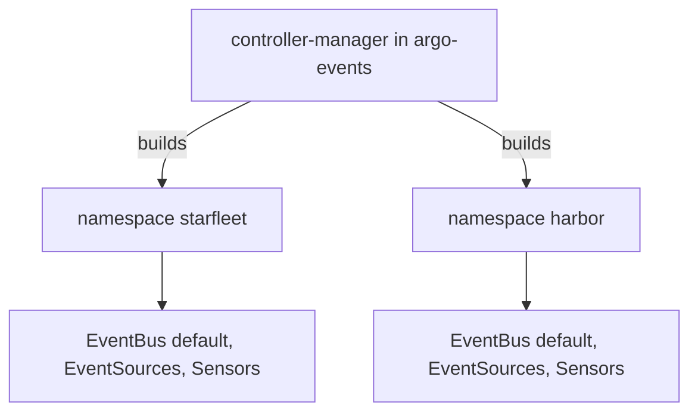

# One Controller For Many Namespaces

A cluster usually serves several teams, and each team wants its own pipelines. Argo Events supports this with one controller and one set of custom resource definitions for the whole cluster, while the pipelines themselves stay inside namespaces. Knowing where the boundary lies tells you what each team has to create, what it can share and why a Sensor never reaches an EventSource in another namespace.

This part creates a second pipeline in a new namespace named `harbor`. It shows that the same controller builds it, that it needs its own EventBus, and how a request from another namespace reaches it.

## What the controller shares and what it does not

The cluster-wide installation runs one `controller-manager` Deployment in the namespace `argo-events`. It watches EventBus, EventSource and Sensor objects in every namespace and builds the Deployments and StatefulSets for them in the namespace of each object. The custom resource definitions are cluster-wide too.

The pipeline objects are not shared. An EventSource and a Sensor find the EventBus in their own namespace, because the field `eventBusName` holds a name and no namespace. A dependency has an `eventSourceName` and no namespace either, so a Sensor can only wait for an EventSource that lives next to it. Two teams in two namespaces therefore get two buses, two sets of server pods and two separate streams of events, and neither team can read the events of the other.

The namespace installation changes the watch, not the boundary. The controller then runs with the flag `--namespaced`, and it manages only one namespace, which is its own unless the flag `--managed-namespace` names another. Use it when a team may not hold a cluster role, or when several controllers of different versions must coexist.



The diagram shows one controller and two namespaces that each hold a complete pipeline of their own.

## Create a pipeline in a new namespace

Create the namespace and look at what it holds. It has no bus yet:

<!-- astrona:playground:renew -->

```sh
kubectl create namespace harbor
kubectl -n harbor get eventbus,eventsources,sensors
```

The second command reports that no resources exist in the namespace. The controller does not create a bus on its own. Save this as `eventbus-harbor.yaml`:

```yaml
apiVersion: argoproj.io/v1alpha1
kind: EventBus
metadata:
  name: default
  namespace: harbor
spec:
  jetstream:
    version: 2.10.10
    replicas: 3
```

Apply it and wait until the controller has built it:

```sh
kubectl apply -f eventbus-harbor.yaml
kubectl -n harbor wait --for=condition=Deployed eventbus/default --timeout=300s
kubectl get eventbus -A
```

The last command lists two buses with the same name, `default`: one in `starfleet` and one in `harbor`. They are two objects in two namespaces, and each one has its own StatefulSet, named `eventbus-default-js`, in its own namespace.

Save this as `pipeline-dock.yaml`. It has an EventSource and a Sensor that logs what arrives:

```yaml
apiVersion: argoproj.io/v1alpha1
kind: EventSource
metadata:
  name: dock
  namespace: harbor
spec:
  service:
    ports:
      - port: 12000
        targetPort: 12000
  webhook:
    arrival:
      port: "12000"
      endpoint: /arrival
      method: POST
---
apiVersion: argoproj.io/v1alpha1
kind: Sensor
metadata:
  name: dock-log
  namespace: harbor
spec:
  dependencies:
    - name: arrival-dep
      eventSourceName: dock
      eventName: arrival
  triggers:
    - template:
        name: print-arrival
        log: {}
```

Apply it and wait until both objects are deployed:

```sh
kubectl apply -f pipeline-dock.yaml
kubectl -n harbor wait --for=condition=Deployed eventsource/dock --timeout=180s
kubectl -n harbor wait --for=condition=Deployed sensor/dock-log --timeout=180s
kubectl -n harbor get pods
```

The pods list has the three bus pods, the EventSource pod and the Sensor pod. The controller in `argo-events` built all of them.

## Reach the pipeline from another namespace

The Service of an EventSource is a normal Kubernetes Service, so a pod in another namespace reaches it with a name that includes the namespace. Send a request from `shuttle` in `starfleet` to the Service `dock-eventsource-svc` in `harbor`:

```sh
kubectl -n starfleet exec shuttle -- curl -s -o /dev/null -w '%{http_code}\n' -X POST \
  -H 'Content-Type: application/json' -d '{"ship":"scout"}' \
  http://dock-eventsource-svc.harbor.svc:12000/arrival
kubectl -n harbor logs -l sensor-name=dock-log --tail=20
```

The status is `200`, and the Sensor in `harbor` logs the event. The event went through the bus of `harbor`, not the bus of `starfleet`. The sender in `starfleet` needed no access to the namespace `harbor` except the network path to the Service.

## What a namespace needs for triggers

A Sensor that creates Workflows needs its own service account with a Role in its namespace, as in `starfleet`. The service account `event-trigger` that the playground created lives in `starfleet` only. A Sensor in `harbor` that used `event-trigger` would fail, because a pod uses a service account of its own namespace. Create the service account and the Role in each namespace that has Sensors with triggers, and give each Role only the verbs and resources that the triggers need.

A trigger can create an object in another namespace when the resource names it in `metadata.namespace`. This works only if the service account of the Sensor has a Role in that other namespace. Use it with care: it moves permissions across the boundary that the namespaces draw.

Delete the namespace when you are done. The command removes everything in it, including the EventBus and its stored events:

```sh
kubectl delete namespace harbor
```

You have seen that one controller serves many namespaces and that each namespace keeps its own bus, EventSources and Sensors. The question this leaves is how the controller itself is configured, and its configuration is cluster-wide: one ConfigMap in `argo-events` sets the defaults for every namespace.

## Common pitfalls

> [!WARNING]
> - **Expecting a Sensor to wait for an EventSource in another namespace.** The dependency has no namespace field, so it reads only events on the bus of its own namespace.
> - **Forgetting the EventBus in a new namespace.** Without a bus, EventSources and Sensors get no pods.
> - **Reusing a service account name and expecting the same rights.** A service account and its Role exist per namespace.
> - **Deleting a namespace to remove one pipeline.** It also deletes the bus and every stored event.
> - **Calling a Service from another namespace by its short name.** Use `<service>.<namespace>.svc`.
